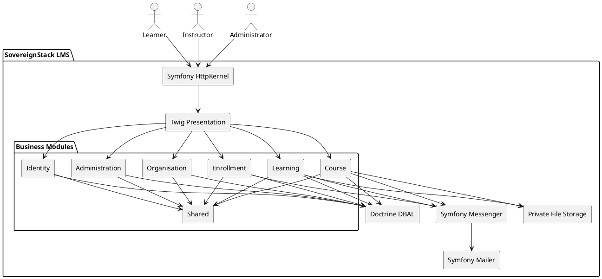
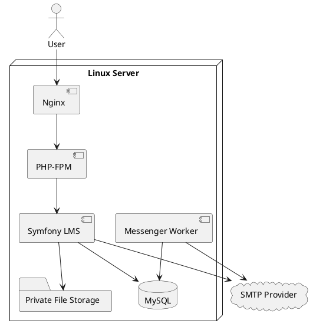

# SPEC-001 — SovereignStack Standalone LMS Architecture and Implementation

**Document status:** Architecture approved; implementation pending explicit authorisation  
**Specification version:** 2.1 (revised)  
**Architecture decisions:** 163 approved (A-001–A-040, D-001–D-040, E-001–E-040, ADR-001–ADR-040, DB-041, DB-042, DB-043)  
**Source project:** DGLab (`https://github.com/DGCodeIdeas/DGLab`)  
**Reported source baseline:** `543329ed84a2148308e0cc455ac7e2fe27cf35f4` (requires reverification before extraction)  
**Target product:** SovereignStack LMS  
**Target repository:** Independent public GitHub repository  
**Language:** PHP 8.4  
**Framework:** Symfony 7.4 LTS  
**Architecture:** Modular Monolith  
**Primary database:** MySQL 8.4 LTS  
**Alternative database:** MariaDB 12.3 LTS (first-class supported)  
**UUID generation:** Symfony UID (`symfony/uid`), UUIDv7  

---

# 1. Background

## 1.1 Purpose

SovereignStack LMS is an independent Learning Management System extracted from the LMS functionality currently embedded within DGLab. The objective is to transform the existing LMS into a standalone, maintainable, independently deployable software product.

The new LMS must retain valuable existing business logic while eliminating dependencies on DGLab's internal application framework. It must also provide a foundation for future development without introducing unnecessary architectural complexity.

## 1.2 Repository strategy

The extraction follows a **copy-not-move** strategy.

| Item | Decision |
|---|---|
| Original application | DGLab |
| Existing LMS location | `Spokes/Internal/Lms/` |
| Extraction method | Copy |
| DGLab LMS | Remains intact as frozen reference |
| DGLab development | Continues independently |
| New LMS repository | Independent public GitHub repository |
| Future LMS development | New repository only |
| Synchronisation | No ongoing two-way synchronisation |

## 1.3 Guiding principles

1. Preserve existing business behaviour wherever appropriate.
2. Remove dependencies on DGLab's application framework.
3. Avoid unnecessary abstractions.
4. Keep the application independently deployable.
5. Prefer Symfony-native capabilities.
6. Maintain clear module boundaries.
7. Protect historical learning records.
8. Make organisation-level data isolation mandatory.
9. Automate quality assurance.
10. Make the implementation directly executable by a development team.

## 1.4 Source baseline

The reported DGLab baseline SHA is:

```
543329ed84a2148308e0cc455ac7e2fe27cf35f4
```

This was verified during Phase 0 inspection as the then-current `origin/main`. It must be **reverified** against the latest shared GitHub `main` before any extraction begins. Do not assume another agent's local worktree, stash, or unpushed commits are accessible.

---

# 2. Requirements

Requirements follow MoSCoW prioritisation.

## 2.1 Must Have

- Independent Symfony application.
- PHP 8.4 compatibility.
- MySQL persistence.
- Doctrine DBAL and Doctrine Migrations.
- Modular monolith architecture.
- Independent authentication and user management.
- Organisation management and membership.
- Course creation and versioning.
- Course publishing and archiving.
- Enrolment management.
- Lesson and module progress tracking.
- Course completion.
- Role-based and resource-level authorisation.
- Secure file uploads and downloads.
- Rich-text course content using HugeRTE.
- Persistent notifications.
- Email delivery.
- Audit logging.
- Organisation data isolation.
- Database migrations.
- Automated testing.
- GitHub Actions CI/CD.
- Independent deployment.
- Automated backups and restoration procedures.

## 2.2 Should Have

- CSV import and export.
- Administrative reporting.
- MySQL full-text search.
- Background processing.
- Data quality monitoring.
- Notification preferences.
- Performance monitoring.
- Operational dashboards.
- Accessibility compliance.
- Internationalisation support.

## 2.3 Could Have

- S3-compatible file storage.
- Dedicated external API.
- Advanced analytics.
- Additional languages.
- Additional notification providers.
- External integrations.

## 2.4 Won't Have Initially

- Microservices.
- Kubernetes.
- Mandatory Redis infrastructure.
- Full CQRS.
- Event sourcing.
- Mandatory frontend SPA.
- Separate read database.
- DGLab Kernel dependency.
- DGLab Hub authentication dependency.
- DGLab-specific deployment requirements.
- Doctrine ORM (not initially required).

---

# 3. Approved Technology Stack

| Layer | Technology | Verified |
|---|---|---|
| Language | PHP 8.4 | Yes |
| Framework | Symfony 7.4 LTS | Yes — see §10.1 |
| Application architecture | Modular Monolith | — |
| Database (primary) | MySQL 8.4 LTS | Yes — see §10.2 |
| Database (alternative) | MariaDB 12.3 LTS | Yes — see §10.2 |
| Database access | Doctrine DBAL 4.5.x | Yes — see §10.2 (corrected: requires PHP ^8.2) |
| Migrations | Doctrine Migrations | — |
| ORM | Not initially required (no doctrine/orm dependency) | — |
| UUID generation | Symfony UID (`symfony/uid`), UUIDv7 | Yes — see §10.5 |
| Templates | Twig | — |
| CSS | Bootstrap 5.3 | — |
| JavaScript | Progressive enhancement | — |
| Rich-text editor | HugeRTE (MIT-licensed) | Yes — see §10.5 |
| Authentication | Symfony Security | — |
| Password hashing | Symfony PasswordHasher | — |
| Email | Symfony Mailer | — |
| Background jobs | Symfony Messenger + `symfony/doctrine-messenger` bridge | Yes — see §10.3 |
| Rate limiting | Symfony RateLimiter | — |
| Cache | Symfony Cache (local initially) | — |
| Logging | Monolog | — |
| Assets | Symfony AssetMapper where compatible | — |
| Testing | PHPUnit | — |
| Static analysis | PHPStan | — |
| CI/CD | GitHub Actions | — |
| Web server | Nginx | — |
| PHP execution | PHP-FPM | — |
| Operating system | Linux | — |
| Redis | Not required (see §3.1) | — |

**Verification note:** Exact package versions, compatibility matrices, and security advisories must be verified against official documentation before implementation and locked in `composer.lock`. The verification status column references §20 (Phase 1 Readiness Assessment).

## 3.1 Database support matrix

| Database | Version | Support level | CI target | Maintained until |
|---|---|---|---|---|
| MySQL | 8.4 LTS | Primary reference; fully supported | Mandatory | April 2032 (LTS) |
| MariaDB | 12.3 LTS | Fully supported alternative (first-class) | Mandatory | June 2029 (LTS) |

**Both databases are mandatory CI test targets.** Every pull request must pass the full integration and migration test suite against BOTH engines. MariaDB is NOT optional, experimental, or best-effort — it is a first-class supported alternative.

**Do not assume MySQL and MariaDB are identical.** Where their behaviour differs (JSON storage, full-text indexing, generated columns, collation, transaction isolation defaults), the differences are documented in §10.6 (MariaDB Compatibility Assessment) and handled explicitly in Infrastructure adapters.

### DB-041: Primary database

MySQL 8.4 LTS is the primary reference database for development, CI, staging, and production compatibility. All schema designs are validated against MySQL 8.4 first.

### DB-042: UUID generation

Use Symfony UID (`symfony/uid`) for UUIDv7 identifier generation.

Requirements:
- UUIDv7 identifiers (timestamp-ordered, lexicographically sortable).
- Consistent canonical representation (36-character hyphenated format).
- Database representation: `CHAR(36)` as previously approved (ADR-004).
- UUID generation is independent of database vendors — IDs are generated in the application layer, never by the database.
- No database-generated UUID dependencies (no `UUID()`, no `uuid_generate_v4()`, no auto-increment fallback).
- Define validation, serialization, and parsing conventions using `Symfony\Component\Uid\UuidV7`.

**Verified:** Symfony 7.4 generates UUIDv7 by default with microsecond precision (symfony.com/blog/new-in-symfony-7-4-uid-improvements, October 2025). The `symfony/uid` package is compatible with PHP 8.2+ and Symfony 7.4+.

### DB-043: First-class MariaDB support

MariaDB 12.3 LTS is an officially supported alternative database engine.

Requirements:
- Both MySQL 8.4 LTS and MariaDB 12.3 LTS must pass the project's required database integration and migration tests.
- The application must not assume MariaDB and MySQL are identical.
- Where behaviour differs, differences must be documented and handled explicitly in Infrastructure adapters.
- No MySQL-specific SQL may appear in Domain or Application layers.
- Vendor-specific behaviour is isolated in Infrastructure/Persistence adapters.

**Verified:** MariaDB 12.3 LTS released May 28, 2026, maintained until June 2029 (mariadb.org/mariadb-server-12-3-lts-released). First GA was 12.3.2; current patch 12.3.3 (August 2026).

## 3.2 Redis policy

Redis is **not mandatory** for the initial release.

- The initial deployment must work without Redis.
- Redis may be introduced later as an optional infrastructure adapter.
- Introduction requires evidence of a specific need, such as:
  - Shared rate-limit state across multiple application instances.
  - Distributed cache requiring cross-instance consistency.
  - Multi-instance session coordination.
  - Asynchronous queue coordination beyond Doctrine transport.
- Any introduction requires a dedicated ADR and updated operational documentation.
- Redis must not become a hidden dependency in the initial architecture. No package may require Redis at construction time; all Redis-using components must be optional adapters behind application-owned interfaces.

## 3.3 Timestamp policy

All application timestamps use `DATETIME(6)` stored in UTC.

This applies to BOTH MySQL 8.4 and MariaDB 12.3 — both engines support `DATETIME(6)` with microsecond precision and identical storage behaviour.

**Why `DATETIME(6)` rather than `TIMESTAMP(6)`:**

| Characteristic | `TIMESTAMP(6)` | `DATETIME(6)` |
|---|---|---|
| Storage (MySQL) | 7 bytes (4 bytes for timestamp + 3 bytes for fractional seconds) | 8 bytes (5 bytes for datetime + 3 bytes for fractional seconds) |
| Storage (MariaDB) | 7 bytes (same as MySQL) | 8 bytes (same as MySQL) |
| Range (MySQL 8.4) | 1970-01-01 00:00:01 to 2038-01-19 03:14:07 UTC | 1000-01-01 to 9999-12-31 |
| Range (MariaDB 12.3) | 1970-01-01 to 2106-02-07 UTC (extended on 64-bit) | 1000-01-01 to 9999-12-31 |
| Timezone behaviour | Automatic conversion: stored as UTC, converted to session `time_zone` on read | No automatic conversion; stores literal value as provided |
| 2038 problem | YES on MySQL (documented range limit) | NO |
| Consistency across MySQL/MariaDB | Range differs between engines (MySQL 2038 vs MariaDB 2106) | Consistent range across both engines |
| Cross-engine portability | Range difference is a portability risk | Deterministic behaviour on both engines |

**Decision:** `DATETIME(6)` is chosen because:

1. It avoids the 2038 range limitation of MySQL `TIMESTAMP` (MariaDB extends TIMESTAMP to 2106, but the range difference between engines is itself a portability risk — `DATETIME(6)` has a consistent range on both).
2. It provides deterministic behaviour regardless of the database engine's `time_zone` session configuration — critical for a system supporting both MySQL and MariaDB.
3. The storage difference is only 1 byte per row (8 bytes for `DATETIME(6)` vs 7 bytes for `TIMESTAMP(6)`), negligible at LMS scale.
4. The application enforces UTC storage explicitly via `DateTimeImmutable` in PHP code, ensuring all values written to `DATETIME(6)` columns are UTC.
5. Timezone conversion to user-preferred timezones happens only in the presentation layer (Twig templates, API DTOs), never in the database or domain layer.
6. Both MySQL 8.4 and MariaDB 12.3 support `DATETIME(6)` with microsecond precision and identical behaviour.

**Application convention:**
- PHP domain and application code uses `DateTimeImmutable` exclusively. `DateTime` (mutable) is forbidden in business logic.
- All `DateTimeImmutable` instances are constructed in UTC (`new DateTimeImmutable('now', new DateTimeZone('UTC'))`).
- The database connection sets `SET time_zone = '+00:00'` as a defensive measure, but the application does not rely on it for correctness.
- Presentation-layer timezone conversion uses `IntlDateFormatter` or Twig's `format_datetime` with the user's preferred timezone.

---

# 4. Architecture

## 4.1 Architectural style

The application uses a **Modular Monolith**. One Symfony application contains independently organised business modules. Each module owns its domain, application services, infrastructure adapters, and presentation responsibilities.

Modules communicate through public application contracts or explicitly defined domain events. No module directly queries another module's database tables.

## 4.2 Module structure

```text
src/
├── Shared/
├── Identity/
├── Organisation/
├── Course/
├── Enrollment/
├── Learning/
└── Administration/
```

Each module follows:

```text
Module/
├── Domain/
│   ├── Entity/
│   ├── ValueObject/
│   ├── Event/
│   ├── Exception/
│   └── Repository/        (interfaces only)
│
├── Application/
│   ├── Command/           (write-side DTOs)
│   ├── Query/             (read-side DTOs)
│   ├── Handler/           (command handlers — write use cases)
│   ├── QueryHandler/      (query handlers — read use cases)
│   ├── Contract/          (public application interfaces)
│   └── DTO/               (shared data transfer objects)
│
├── Infrastructure/
│   ├── Persistence/       (DBAL repository implementations)
│   └── Integration/       (external service adapters)
│
└── Presentation/
    ├── Controller/        (thin Symfony controllers)
    ├── Form/              (Symfony Forms)
    └── View/              (Twig templates)
```

**Directory discipline:**

- `Application/Service/` is **not** used. Write use cases live in `Handler/`; read use cases live in `QueryHandler/`. This is pragmatic CQRS — commands and queries are separated at the application layer without requiring separate databases or full CQRS infrastructure.
- `Application/Contract/` holds the public interfaces other modules depend on. A module's internal `Handler/` and `QueryHandler/` classes are NOT directly imported by other modules; they depend on the contracts.
- Shared application services are allowed where genuine reuse exists (e.g., a shared `TransactionManager`), but these live in `Shared/`, not in individual business modules.
- Domain logic remains inside domain entities and domain services. Controllers, handlers, and query handlers are orchestration layers, not business-rule owners.

### 4.2.1 Concrete example — Course module

```text
src/Course/
├── Domain/
│   ├── Entity/
│   │   ├── Course.php
│   │   ├── CourseVersion.php
│   │   ├── Module.php
│   │   └── Lesson.php
│   ├── ValueObject/
│   │   ├── CourseId.php
│   │   ├── CourseSlug.php
│   │   ├── CourseTitle.php
│   │   ├── CourseVisibility.php
│   │   ├── ModuleId.php
│   │   └── LessonId.php
│   ├── Event/
│   │   ├── CourseCreated.php
│   │   ├── CourseSubmittedForReview.php
│   │   ├── CoursePublished.php
│   │   ├── CourseArchived.php
│   │   └── ModuleAdded.php
│   ├── Exception/
│   │   ├── CourseNotFoundException.php
│   │   ├── InvalidCourseTransitionException.php
│   │   └── DuplicateCourseSlugException.php
│   └── Repository/
│       ├── CourseRepositoryInterface.php
│       ├── CourseVersionRepositoryInterface.php
│       └── ModuleRepositoryInterface.php
│
├── Application/
│   ├── Command/
│   │   ├── CreateCourseCommand.php
│   │   ├── UpdateCourseCommand.php
│   │   ├── SubmitForReviewCommand.php
│   │   ├── PublishCourseCommand.php
│   │   ├── ArchiveCourseCommand.php
│   │   ├── AddModuleCommand.php
│   │   └── RemoveModuleCommand.php
│   ├── Query/
│   │   ├── ListPublishedCoursesQuery.php
│   │   └── GetCourseDetailQuery.php
│   ├── Handler/
│   │   ├── CreateCourseHandler.php
│   │   ├── SubmitForReviewHandler.php
│   │   ├── PublishCourseHandler.php
│   │   └── ArchiveCourseHandler.php
│   ├── QueryHandler/
│   │   ├── ListPublishedCoursesHandler.php
│   │   └── GetCourseDetailHandler.php
│   ├── Contract/
│   │   └── CourseApplicationInterface.php
│   └── DTO/
│       ├── CourseSummaryDTO.php
│       └── CourseDetailDTO.php
│
├── Infrastructure/
│   └── Persistence/
│       ├── MySQLCourseRepository.php
│       ├── MySQLCourseVersionRepository.php
│       └── MySQLModuleRepository.php
│
└── Presentation/
    ├── Controller/
    │   └── CourseController.php
    ├── Form/
    │   ├── CourseFormType.php
    │   └── ModuleFormType.php
    └── View/
        └── course/
            ├── list.html.twig
            ├── detail.html.twig
            └── edit.html.twig
```

### 4.2.2 Concrete example — Enrollment module

```text
src/Enrollment/
├── Domain/
│   ├── Entity/
│   │   └── Enrollment.php
│   ├── ValueObject/
│   │   ├── EnrollmentId.php
│   │   └── EnrollmentStatus.php
│   ├── Event/
│   │   ├── EnrollmentCreated.php
│   │   ├── EnrollmentCancelled.php
│   │   └── EnrollmentCompleted.php
│   ├── Exception/
│   │   ├── AlreadyEnrolledException.php
│   │   ├── EnrollmentNotFoundException.php
│   │   └── InvalidEnrollmentTransitionException.php
│   └── Repository/
│       └── EnrollmentRepositoryInterface.php
│
├── Application/
│   ├── Command/
│   │   ├── EnrollCommand.php
│   │   ├── CancelEnrollmentCommand.php
│   │   └── CompleteEnrollmentCommand.php
│   ├── Query/
│   │   ├── ListEnrollmentsForLearnerQuery.php
│   │   └── ListEnrollmentsForCourseQuery.php
│   ├── Handler/
│   │   ├── EnrollHandler.php
│   │   ├── CancelEnrollmentHandler.php
│   │   └── CompleteEnrollmentHandler.php
│   ├── QueryHandler/
│   │   ├── ListEnrollmentsForLearnerHandler.php
│   │   └── ListEnrollmentsForCourseHandler.php
│   ├── Contract/
│   │   └── EnrollmentApplicationInterface.php
│   └── DTO/
│       ├── EnrollmentSummaryDTO.php
│       └── EnrollmentDetailDTO.php
│
├── Infrastructure/
│   └── Persistence/
│       └── MySQLEnrollmentRepository.php
│
└── Presentation/
    ├── Controller/
    │   └── EnrollmentController.php
    └── View/
        └── enrollment/
            ├── list.html.twig
            └── detail.html.twig
```

## 4.3 Dependency rules

1. **Domain must not depend on Symfony.** No `use Symfony\*` in any Domain file.
2. **Domain must not depend on Doctrine.** No `use Doctrine\*` in any Domain file. Repository interfaces use module-owned types only.
3. **Application must not depend on HTTP infrastructure.** No `use Symfony\Component\HttpFoundation\*` or `use Symfony\Component\HttpKernel\*` in Application files. Controllers translate HTTP ↔ application DTOs.
4. **Infrastructure implements module-owned contracts.** Repository interfaces live in Domain; DBAL implementations live in Infrastructure.
5. **Presentation must not contain business logic.** Controllers delegate to application handlers; Twig templates render DTOs.
6. **Controllers must remain thin.** A controller's body is: parse request → construct command → call handler → format response.
7. **Modules cannot directly query another module's tables.** Cross-module reads go through that module's query handlers or query services.
8. **Cross-module foreign keys are allowed for integrity.** A `enrollments.course_version_id` FK to `course_versions.id` is permitted; but the Enrollment module does not `SELECT FROM course_versions` directly — it calls `CourseApplicationInterface::getCourseVersion()`.
9. **Dependency injection uses constructor injection.** No service locators, no `$container->get()` in business code.
10. **Business code must not use service locators.** The Symfony container is available only in configuration and presentation wiring.

Architecture tests (PHPStan rules + custom tests) enforce these restrictions in CI.

## 4.4 Component diagram



---

# 5. Data Architecture

## 5.1 Database principles

- MySQL relational schema.
- Lowercase snake_case table names.
- Module-owned tables and migrations.
- Explicit foreign keys.
- Appropriate unique constraints.
- Indexed query patterns based on actual access profiles.
- UUIDv7 identifiers stored as `CHAR(36)`.
- UTC `DATETIME(6)` timestamps (see §3.2).
- JSON only for genuinely flexible metadata.
- No unnecessary generic schemas.
- `DateTimeImmutable` in PHP application code.

## 5.2 Identity schema

```sql
CREATE TABLE users (
    id                  CHAR(36)      NOT NULL PRIMARY KEY,
    email               VARCHAR(255)  NOT NULL,
    password_hash       VARCHAR(255)  NOT NULL,
    status              VARCHAR(32)   NOT NULL DEFAULT 'pending_verification',
    email_verified_at   DATETIME(6)   NULL,
    failed_login_count  INT           NOT NULL DEFAULT 0,
    locked_until        DATETIME(6)   NULL,
    last_login_at       DATETIME(6)   NULL,
    created_at          DATETIME(6)   NOT NULL,
    updated_at          DATETIME(6)   NOT NULL,
    UNIQUE KEY uq_users_email (email),
    KEY idx_users_status (status)
) ENGINE=InnoDB DEFAULT CHARSET=utf8mb4;

CREATE TABLE user_profiles (
    id              CHAR(36)      NOT NULL PRIMARY KEY,
    user_id         CHAR(36)      NOT NULL,
    display_name    VARCHAR(255)  NOT NULL,
    preferred_tz    VARCHAR(64)   NOT NULL DEFAULT 'UTC',
    metadata        JSON          NULL,
    created_at      DATETIME(6)   NOT NULL,
    updated_at      DATETIME(6)   NOT NULL,
    UNIQUE KEY uq_user_profiles_user (user_id),
    CONSTRAINT fk_profiles_user FOREIGN KEY (user_id) REFERENCES users(id) ON DELETE RESTRICT
) ENGINE=InnoDB DEFAULT CHARSET=utf8mb4;

CREATE TABLE roles (
    id          CHAR(36)      NOT NULL PRIMARY KEY,
    code        VARCHAR(64)   NOT NULL,
    name        VARCHAR(255)  NOT NULL,
    description TEXT          NULL,
    created_at  DATETIME(6)   NOT NULL,
    UNIQUE KEY uq_roles_code (code)
) ENGINE=InnoDB DEFAULT CHARSET=utf8mb4;

CREATE TABLE permissions (
    id          CHAR(36)      NOT NULL PRIMARY KEY,
    code        VARCHAR(128)  NOT NULL,
    description TEXT          NULL,
    created_at  DATETIME(6)   NOT NULL,
    UNIQUE KEY uq_permissions_code (code)
) ENGINE=InnoDB DEFAULT CHARSET=utf8mb4;

CREATE TABLE role_permissions (
    role_id         CHAR(36)  NOT NULL,
    permission_id   CHAR(36)  NOT NULL,
    PRIMARY KEY (role_id, permission_id),
    CONSTRAINT fk_rp_role FOREIGN KEY (role_id) REFERENCES roles(id) ON DELETE CASCADE,
    CONSTRAINT fk_rp_perm FOREIGN KEY (permission_id) REFERENCES permissions(id) ON DELETE CASCADE
) ENGINE=InnoDB DEFAULT CHARSET=utf8mb4;

CREATE TABLE user_roles (
    id              CHAR(36)      NOT NULL PRIMARY KEY,
    user_id         CHAR(36)      NOT NULL,
    role_id         CHAR(36)      NOT NULL,
    organisation_id CHAR(36)      NULL,
    assigned_by     CHAR(36)      NULL,
    assigned_at     DATETIME(6)   NOT NULL,
    KEY idx_user_roles_user (user_id),
    KEY idx_user_roles_org (organisation_id),
    CONSTRAINT fk_ur_user FOREIGN KEY (user_id) REFERENCES users(id) ON DELETE CASCADE,
    CONSTRAINT fk_ur_role FOREIGN KEY (role_id) REFERENCES roles(id) ON DELETE RESTRICT
) ENGINE=InnoDB DEFAULT CHARSET=utf8mb4;
```

## 5.3 Organisation schema

```sql
CREATE TABLE organisations (
    id          CHAR(36)      NOT NULL PRIMARY KEY,
    name        VARCHAR(255)  NOT NULL,
    slug        VARCHAR(255)  NOT NULL,
    status      VARCHAR(32)   NOT NULL DEFAULT 'active',
    timezone    VARCHAR(64)   NOT NULL DEFAULT 'UTC',
    settings    JSON          NULL,
    created_at  DATETIME(6)   NOT NULL,
    updated_at  DATETIME(6)   NOT NULL,
    UNIQUE KEY uq_orgs_slug (slug)
) ENGINE=InnoDB DEFAULT CHARSET=utf8mb4;

CREATE TABLE organisation_memberships (
    id              CHAR(36)      NOT NULL PRIMARY KEY,
    organisation_id CHAR(36)      NOT NULL,
    user_id         CHAR(36)      NOT NULL,
    status          VARCHAR(32)   NOT NULL DEFAULT 'active',
    joined_at       DATETIME(6)   NULL,
    ended_at        DATETIME(6)   NULL,
    created_at      DATETIME(6)   NOT NULL,
    UNIQUE KEY uq_org_user (organisation_id, user_id),
    KEY idx_membership_user (user_id),
    CONSTRAINT fk_mem_org FOREIGN KEY (organisation_id) REFERENCES organisations(id) ON DELETE RESTRICT,
    CONSTRAINT fk_mem_user FOREIGN KEY (user_id) REFERENCES users(id) ON DELETE CASCADE
) ENGINE=InnoDB DEFAULT CHARSET=utf8mb4;
```

## 5.4 Course schema

```sql
CREATE TABLE courses (
    id                              CHAR(36)      NOT NULL PRIMARY KEY,
    organisation_id                 CHAR(36)      NOT NULL,
    owner_user_id                   CHAR(36)      NOT NULL,
    slug                            VARCHAR(255)  NOT NULL,
    current_published_version_id    CHAR(36)      NULL,
    visibility                      VARCHAR(32)   NOT NULL DEFAULT 'organisation_only',
    created_at                      DATETIME(6)   NOT NULL,
    updated_at                      DATETIME(6)   NOT NULL,
    UNIQUE KEY uq_courses_org_slug (organisation_id, slug),
    KEY idx_courses_org (organisation_id),
    CONSTRAINT fk_courses_org FOREIGN KEY (organisation_id) REFERENCES organisations(id) ON DELETE RESTRICT,
    CONSTRAINT fk_courses_owner FOREIGN KEY (owner_user_id) REFERENCES users(id) ON DELETE RESTRICT
    -- NOTE: current_published_version_id FK is added AFTER course_versions table is created
) ENGINE=InnoDB DEFAULT CHARSET=utf8mb4;

CREATE TABLE course_versions (
    id              CHAR(36)      NOT NULL PRIMARY KEY,
    course_id       CHAR(36)      NOT NULL,
    version_number  INT UNSIGNED  NOT NULL,
    title           VARCHAR(255)  NOT NULL,
    description     TEXT          NULL,
    status          VARCHAR(32)   NOT NULL DEFAULT 'draft',
    published_at    DATETIME(6)   NULL,
    created_by      CHAR(36)      NOT NULL,
    created_at      DATETIME(6)   NOT NULL,
    UNIQUE KEY uq_cv_course_version (course_id, version_number),
    KEY idx_cv_course (course_id),
    CONSTRAINT fk_cv_course FOREIGN KEY (course_id) REFERENCES courses(id) ON DELETE RESTRICT
) ENGINE=InnoDB DEFAULT CHARSET=utf8mb4;

-- Add FK from courses.current_published_version_id to course_versions.id
ALTER TABLE courses
ADD CONSTRAINT fk_courses_published_version
FOREIGN KEY (current_published_version_id) REFERENCES course_versions(id) ON DELETE SET NULL;

CREATE TABLE course_modules (
    id                  CHAR(36)      NOT NULL PRIMARY KEY,
    course_version_id   CHAR(36)      NOT NULL,
    title               VARCHAR(255)  NOT NULL,
    description         TEXT          NULL,
    position            INT           NOT NULL DEFAULT 0,
    is_required         TINYINT(1)    NOT NULL DEFAULT 1,
    created_at          DATETIME(6)   NOT NULL,
    updated_at          DATETIME(6)   NOT NULL,
    KEY idx_cm_version_position (course_version_id, position),
    CONSTRAINT fk_cm_version FOREIGN KEY (course_version_id) REFERENCES course_versions(id) ON DELETE CASCADE
) ENGINE=InnoDB DEFAULT CHARSET=utf8mb4;

CREATE TABLE lessons (
    id                  CHAR(36)      NOT NULL PRIMARY KEY,
    course_module_id    CHAR(36)      NOT NULL,
    title               VARCHAR(255)  NOT NULL,
    position            INT           NOT NULL DEFAULT 0,
    created_at          DATETIME(6)   NOT NULL,
    updated_at          DATETIME(6)   NOT NULL,
    KEY idx_lessons_module_position (course_module_id, position),
    CONSTRAINT fk_lessons_module FOREIGN KEY (course_module_id) REFERENCES course_modules(id) ON DELETE CASCADE
) ENGINE=InnoDB DEFAULT CHARSET=utf8mb4;

CREATE TABLE lesson_contents (
    id          CHAR(36)      NOT NULL PRIMARY KEY,
    lesson_id   CHAR(36)      NOT NULL,
    content_html LONGTEXT     NOT NULL,
    content_metadata JSON     NULL,
    created_at  DATETIME(6)   NOT NULL,
    updated_at  DATETIME(6)   NOT NULL,
    UNIQUE KEY uq_lc_lesson (lesson_id),
    CONSTRAINT fk_lc_lesson FOREIGN KEY (lesson_id) REFERENCES lessons(id) ON DELETE CASCADE
) ENGINE=InnoDB DEFAULT CHARSET=utf8mb4;

CREATE TABLE course_categories (
    id              CHAR(36)      NOT NULL PRIMARY KEY,
    organisation_id CHAR(36)      NOT NULL,
    name            VARCHAR(255)  NOT NULL,
    slug            VARCHAR(255)  NOT NULL,
    created_at      DATETIME(6)   NOT NULL,
    UNIQUE KEY uq_cat_org_slug (organisation_id, slug),
    CONSTRAINT fk_cat_org FOREIGN KEY (organisation_id) REFERENCES organisations(id) ON DELETE CASCADE
) ENGINE=InnoDB DEFAULT CHARSET=utf8mb4;

CREATE TABLE course_category_assignments (
    course_id       CHAR(36)  NOT NULL,
    category_id     CHAR(36)  NOT NULL,
    PRIMARY KEY (course_id, category_id),
    CONSTRAINT fk_cca_course FOREIGN KEY (course_id) REFERENCES courses(id) ON DELETE CASCADE,
    CONSTRAINT fk_cca_cat FOREIGN KEY (category_id) REFERENCES course_categories(id) ON DELETE CASCADE
) ENGINE=InnoDB DEFAULT CHARSET=utf8mb4;

CREATE TABLE course_instructors (
    id              CHAR(36)      NOT NULL PRIMARY KEY,
    course_id       CHAR(36)      NOT NULL,
    user_id         CHAR(36)      NOT NULL,
    assigned_by     CHAR(36)      NOT NULL,
    assigned_at     DATETIME(6)   NOT NULL,
    effective_from  DATETIME(6)   NOT NULL,
    effective_until DATETIME(6)   NULL,
    KEY idx_instr_course (course_id),
    KEY idx_instr_user (user_id),
    CONSTRAINT fk_instr_course FOREIGN KEY (course_id) REFERENCES courses(id) ON DELETE RESTRICT,
    CONSTRAINT fk_instr_user FOREIGN KEY (user_id) REFERENCES users(id) ON DELETE RESTRICT
) ENGINE=InnoDB DEFAULT CHARSET=utf8mb4;
```

### 5.4.1 Course-version referential integrity

The existing design uses `courses.current_published_version_id` as a simple FK to `course_versions.id`. **A simple FK is insufficient** — it does not enforce that the referenced version belongs to the same course.

**Problem:** Without a composite constraint, a course could reference a version belonging to a different course, creating a data integrity violation.

**Solution: Composite unique key + composite foreign key.**

```sql
-- Step 1: Add a unique constraint on (id, course_id) in course_versions
-- This allows a composite FK from courses that references both columns
ALTER TABLE course_versions
ADD UNIQUE KEY uq_cv_id_course (id, course_id);

-- Step 2: Add course_id to courses as a denormalized column for the composite FK
-- (current_published_version_id already exists; we add current_published_version_course_id)
ALTER TABLE courses
ADD COLUMN current_published_version_course_id CHAR(36) NULL AFTER current_published_version_id;

-- Step 3: Add composite FK
ALTER TABLE courses
ADD CONSTRAINT fk_courses_published_version
FOREIGN KEY (current_published_version_id, current_published_version_course_id)
REFERENCES course_versions(id, course_id)
ON DELETE SET NULL;
```

**Application invariant:** When publishing a version, the application sets BOTH `current_published_version_id` AND `current_published_version_course_id` to the version's ID and the course's ID respectively, within the same transaction. The composite FK ensures the version belongs to the course.

**Migration order:**
1. Create `course_versions` table with `UNIQUE KEY uq_cv_id_course (id, course_id)`.
2. Create `courses` table with `current_published_version_id` + `current_published_version_course_id` columns.
3. Add composite FK.

**Publication transaction:**
```sql
BEGIN;
INSERT INTO course_versions (id, course_id, version_number, title, ...) VALUES (...);
UPDATE courses SET 
    current_published_version_id = ?, 
    current_published_version_course_id = ?,
    updated_at = UTC_TIMESTAMP(6)
WHERE id = ?;
COMMIT;
```

**Archiving a course:**
```sql
BEGIN;
UPDATE course_versions SET status = 'archived' WHERE id = ?;
UPDATE courses SET 
    current_published_version_id = NULL,
    current_published_version_course_id = NULL,
    updated_at = UTC_TIMESTAMP(6)
WHERE id = ?;
COMMIT;
```

**Nullability:** Both `current_published_version_id` and `current_published_version_course_id` are NULLABLE (a course may have no published version yet, or may be archived). Both must be NULL or both must be non-NULL — enforced at the application layer.

**ON DELETE SET NULL:** If a version row is erroneously deleted, both FK columns on the course are set to NULL rather than cascading the deletion. The course row survives.

**Tested against both engines:** The composite FK pattern is standard SQL and supported by both MySQL 8.4 and MariaDB 12.3. Both engines enforce composite foreign keys identically.

### 5.4.2 Course schema redundancy resolution

The original DGLab schema (migrations 001–009) stored `version` and `requirements_snapshot` directly on `lms_courses` AND in a separate `lms_course_versions` table — redundant storage that risked consistency drift.

The standalone schema resolves this cleanly:

- **`courses`** represents stable course identity and ownership (organisation, owner, slug, visibility). It does NOT carry version number or requirements snapshot.
- **`course_versions`** represents immutable published versions and editable drafts. Each version carries its own `title`, `description`, `status`, `published_at`, and `created_by`.
- **`courses.current_published_version_id`** is a nullable FK to `course_versions.id`. It identifies the currently published version (if any). It uses `ON DELETE SET NULL` so archiving a version does not delete the course.
- **Enrollments reference `course_versions.id`** (the exact version the learner enrolled in), not `courses.id` alone.
- **Module requirements belong to the version** via `course_modules.course_version_id`, not duplicated on the course row.

**Legacy columns intentionally NOT carried forward:**
- `lms_courses.version` → replaced by `course_versions.version_number` and `courses.current_published_version_id` FK
- `lms_courses.requirements_snapshot` (JSON) → replaced by querying `course_modules` for the version's module set

**Transaction implications of `current_published_version_id`:**
- Publishing a new version: insert `course_versions` row → update `courses.current_published_version_id` + `current_published_version_course_id` to the new version ID + course ID → commit. Both operations are in one transaction. If the transaction fails, the course still points to the previous published version (or NULL).
- Archiving a course: set `course_versions.status = 'archived'` → set `courses.current_published_version_id = NULL` + `current_published_version_course_id = NULL` → commit. Existing enrollments retain their `course_version_id` reference and remain accessible.
- The composite FK `ON DELETE SET NULL` ensures that even if a version row is erroneously deleted, the course row survives with both FK columns set to NULL rather than cascading a deletion.

## 5.5 Enrollment schema

```sql
CREATE TABLE enrollments (
    id                  CHAR(36)      NOT NULL PRIMARY KEY,
    organisation_id     CHAR(36)      NOT NULL,
    learner_user_id     CHAR(36)      NOT NULL,
    course_id           CHAR(36)      NOT NULL,
    course_version_id   CHAR(36)      NOT NULL,
    status              VARCHAR(32)   NOT NULL DEFAULT 'active',
    enrolled_at         DATETIME(6)   NOT NULL,
    completed_at        DATETIME(6)   NULL,
    cancelled_at        DATETIME(6)   NULL,
    created_at          DATETIME(6)   NOT NULL,
    updated_at          DATETIME(6)   NOT NULL,
    _active_flag        SMALLINT      GENERATED ALWAYS AS (CASE WHEN status = 'active' THEN 1 ELSE NULL END) VIRTUAL,
    UNIQUE KEY uq_active_enrollment (learner_user_id, course_id, _active_flag),
    KEY idx_enrollments_learner (learner_user_id, status),
    KEY idx_enrollments_course (course_id, status),
    KEY idx_enrollments_org (organisation_id),
    CONSTRAINT fk_enr_org FOREIGN KEY (organisation_id) REFERENCES organisations(id) ON DELETE RESTRICT,
    CONSTRAINT fk_enr_learner FOREIGN KEY (learner_user_id) REFERENCES users(id) ON DELETE RESTRICT,
    CONSTRAINT fk_enr_course FOREIGN KEY (course_id) REFERENCES courses(id) ON DELETE RESTRICT,
    CONSTRAINT fk_enr_version FOREIGN KEY (course_version_id) REFERENCES course_versions(id) ON DELETE RESTRICT
) ENGINE=InnoDB DEFAULT CHARSET=utf8mb4;
```

**One active enrollment enforcement:** The generated column `_active_flag` is `1` when `status = 'active'` and `NULL` otherwise. The unique key `uq_active_enrollment (learner_user_id, course_id, _active_flag)` allows multiple cancelled/completed enrollments for the same (learner, course) pair but prevents duplicate active enrollments. MySQL ignores NULL values in unique indexes, so the NULL `_active_flag` for non-active rows does not conflict.

**This is the same pattern used in DGLab migration 008/009**, verified as MySQL-compatible. An alternative application-level enforcement (check before insert within a transaction) is also acceptable but the generated-column approach provides a database-level guarantee.

## 5.6 Learning schema

```sql
CREATE TABLE module_progress (
    id              CHAR(36)      NOT NULL PRIMARY KEY,
    enrollment_id   CHAR(36)      NOT NULL,
    course_module_id CHAR(36)     NOT NULL,
    status          VARCHAR(32)   NOT NULL DEFAULT 'not_started',
    started_at      DATETIME(6)   NULL,
    completed_at    DATETIME(6)   NULL,
    updated_at      DATETIME(6)   NOT NULL,
    version         INT           NOT NULL DEFAULT 1,
    UNIQUE KEY uq_mp_enrollment_module (enrollment_id, course_module_id),
    KEY idx_mp_status (status),
    CONSTRAINT fk_mp_enrollment FOREIGN KEY (enrollment_id) REFERENCES enrollments(id) ON DELETE CASCADE,
    CONSTRAINT fk_mp_module FOREIGN KEY (course_module_id) REFERENCES course_modules(id) ON DELETE RESTRICT
) ENGINE=InnoDB DEFAULT CHARSET=utf8mb4;

CREATE TABLE lesson_progress (
    id              CHAR(36)      NOT NULL PRIMARY KEY,
    enrollment_id   CHAR(36)      NOT NULL,
    lesson_id       CHAR(36)      NOT NULL,
    status          VARCHAR(32)   NOT NULL DEFAULT 'not_started',
    progress_data   JSON          NULL,
    started_at      DATETIME(6)   NULL,
    completed_at    DATETIME(6)   NULL,
    updated_at      DATETIME(6)   NOT NULL,
    version         INT           NOT NULL DEFAULT 1,
    UNIQUE KEY uq_lp_enrollment_lesson (enrollment_id, lesson_id),
    CONSTRAINT fk_lp_enrollment FOREIGN KEY (enrollment_id) REFERENCES enrollments(id) ON DELETE CASCADE,
    CONSTRAINT fk_lp_lesson FOREIGN KEY (lesson_id) REFERENCES lessons(id) ON DELETE RESTRICT
) ENGINE=InnoDB DEFAULT CHARSET=utf8mb4;

CREATE TABLE course_completions (
    id                  CHAR(36)      NOT NULL PRIMARY KEY,
    enrollment_id       CHAR(36)      NOT NULL,
    learner_user_id     CHAR(36)      NOT NULL,
    course_id           CHAR(36)      NOT NULL,
    course_version_id   CHAR(36)      NOT NULL,
    completed_at        DATETIME(6)   NOT NULL,
    created_at          DATETIME(6)   NOT NULL,
    UNIQUE KEY uq_completion_enrollment (enrollment_id),
    KEY idx_completion_learner (learner_user_id),
    KEY idx_completion_course (course_id),
    CONSTRAINT fk_cc_enrollment FOREIGN KEY (enrollment_id) REFERENCES enrollments(id) ON DELETE RESTRICT,
    CONSTRAINT fk_cc_learner FOREIGN KEY (learner_user_id) REFERENCES users(id) ON DELETE RESTRICT,
    CONSTRAINT fk_cc_course FOREIGN KEY (course_id) REFERENCES courses(id) ON DELETE RESTRICT,
    CONSTRAINT fk_cc_version FOREIGN KEY (course_version_id) REFERENCES course_versions(id) ON DELETE RESTRICT
) ENGINE=InnoDB DEFAULT CHARSET=utf8mb4;
```

**`course_completions` is a durable, append-once record.** The `UNIQUE KEY uq_completion_enrollment (enrollment_id)` ensures at most one completion record per enrollment (idempotency). The `ON DELETE RESTRICT` on the enrollment FK prevents deleting an enrollment that has a completion record — historical learning records are preserved.

**Optimistic locking:** `module_progress` and `lesson_progress` carry a `version INT` column for optimistic locking. The application reads the version, modifies the row, and updates with `WHERE id = ? AND version = ?`. If the row count is 0, another process modified the record and the operation retries or fails with a conflict.

## 5.7 Audit schema

```sql
CREATE TABLE audit_events (
    id              CHAR(36)      NOT NULL PRIMARY KEY,
    event_type      VARCHAR(128)  NOT NULL,
    actor_user_id   CHAR(36)      NULL,
    organisation_id CHAR(36)      NULL,
    resource_type   VARCHAR(64)   NOT NULL,
    resource_id     CHAR(36)      NOT NULL,
    event_data      JSON          NULL,
    ip_address      VARCHAR(45)   NULL,
    occurred_at     DATETIME(6)   NOT NULL,
    correlation_id  CHAR(36)      NOT NULL,
    KEY idx_audit_actor (actor_user_id, occurred_at),
    KEY idx_audit_org (organisation_id, occurred_at),
    KEY idx_audit_resource (resource_type, resource_id, occurred_at),
    KEY idx_audit_type (event_type, occurred_at),
    KEY idx_audit_correlation (correlation_id)
) ENGINE=InnoDB DEFAULT CHARSET=utf8mb4;
```

**Append-only behaviour:**
- No `UPDATE` or `DELETE` statements are issued against `audit_events` by any application code path.
- The application enforces append-only at the repository level: `AuditEventRepositoryInterface` exposes only `append(AuditEvent $event): void`. No `update()` or `delete()` methods exist on the interface.
- Database-level protection: a future migration may add a `BEFORE UPDATE` trigger that raises an error if any row in `audit_events` is updated. This is deferred until production deployment to avoid migration complexity during development.

**JSON payload constraints:**
- `event_data` is a JSON column storing structured event details (e.g., `{"field_changed": "status", "old_value": "draft", "new_value": "published"}`).
- The application validates the JSON structure before insertion.
- Sensitive data is excluded by an allowlist filter in the `AuditEvent` value object. The following are NEVER stored in `event_data`:
  - Passwords (current or historical)
  - Password hashes
  - Session tokens
  - Email verification tokens
  - Password reset tokens
  - API keys
  - Full credit card numbers
  - Biometric data
- `ip_address` is stored for security-relevant events only (login, password change, role assignment). It is NOT stored for routine business events (course viewed, lesson started).

**Retention and privacy:**
- Audit events are retained per the approved retention schedule (D-039).
- Deletion of audit events requires explicit administrative authorisation and is itself audited.
- Personal data in audit events (actor_user_id, ip_address) is subject to the privacy policy (E-035). Anonymisation is applied after the retention period expires.
- The `actor_user_id` column is nullable to allow system-initiated events (e.g., scheduled maintenance jobs) where no human actor exists.

**Index rationale:**
- `idx_audit_actor`: "show me all actions by this user" queries
- `idx_audit_org`: "show me all audit events in this organisation" queries
- `idx_audit_resource`: "show me the audit history of this resource" queries
- `idx_audit_type`: "show me all course_publication events" queries
- `idx_audit_correlation`: trace a single request across multiple audit entries

## 5.8 Notification schema

```sql
CREATE TABLE notifications (
    id                  CHAR(36)      NOT NULL PRIMARY KEY,
    organisation_id     CHAR(36)      NOT NULL,
    recipient_user_id   CHAR(36)      NOT NULL,
    notification_type   VARCHAR(128)  NOT NULL,
    resource_type       VARCHAR(64)   NULL,
    resource_id         CHAR(36)      NULL,
    title               VARCHAR(255)  NOT NULL,
    body                TEXT          NOT NULL,
    read_at             DATETIME(6)   NULL,
    created_at          DATETIME(6)   NOT NULL,
    KEY idx_notif_recipient (recipient_user_id, read_at),
    KEY idx_notif_org (organisation_id),
    CONSTRAINT fk_notif_org FOREIGN KEY (organisation_id) REFERENCES organisations(id) ON DELETE RESTRICT,
    CONSTRAINT fk_notif_recipient FOREIGN KEY (recipient_user_id) REFERENCES users(id) ON DELETE CASCADE
) ENGINE=InnoDB DEFAULT CHARSET=utf8mb4;

CREATE TABLE email_deliveries (
    id              CHAR(36)      NOT NULL PRIMARY KEY,
    notification_id CHAR(36)      NULL,
    recipient_email VARCHAR(255)  NOT NULL,
    subject         VARCHAR(255)  NOT NULL,
    body_html       LONGTEXT      NOT NULL,
    status          VARCHAR(32)   NOT NULL DEFAULT 'pending',
    attempts        INT           NOT NULL DEFAULT 0,
    last_attempt_at DATETIME(6)   NULL,
    delivered_at    DATETIME(6)   NULL,
    failure_reason  TEXT          NULL,
    created_at      DATETIME(6)   NOT NULL,
    KEY idx_email_status (status),
    KEY idx_email_notification (notification_id),
    CONSTRAINT fk_email_notif FOREIGN KEY (notification_id) REFERENCES notifications(id) ON DELETE SET NULL
) ENGINE=InnoDB DEFAULT CHARSET=utf8mb4;

CREATE TABLE notification_preferences (
    id                  CHAR(36)      NOT NULL PRIMARY KEY,
    user_id             CHAR(36)      NOT NULL,
    notification_type   VARCHAR(128)  NOT NULL,
    channel             VARCHAR(32)   NOT NULL,
    enabled             TINYINT(1)    NOT NULL DEFAULT 1,
    UNIQUE KEY uq_pref_user_type_channel (user_id, notification_type, channel),
    CONSTRAINT fk_pref_user FOREIGN KEY (user_id) REFERENCES users(id) ON DELETE CASCADE
) ENGINE=InnoDB DEFAULT CHARSET=utf8mb4;
```

**Idempotent delivery:** A failed email delivery does NOT erase the in-app notification. The `notification_id` FK on `email_deliveries` is `ON DELETE SET NULL` so deleting a notification does not lose delivery history, and deleting a delivery record does not affect the notification.

## 5.9 File schema

```sql
CREATE TABLE files (
    id                  CHAR(36)      NOT NULL PRIMARY KEY,
    organisation_id     CHAR(36)      NOT NULL,
    uploaded_by         CHAR(36)      NOT NULL,
    storage_key         VARCHAR(255)  NOT NULL,
    original_filename   VARCHAR(255)  NOT NULL,
    mime_type           VARCHAR(127)  NOT NULL,
    file_size           BIGINT        NOT NULL,
    checksum            VARCHAR(64)   NOT NULL,
    visibility          VARCHAR(32)   NOT NULL DEFAULT 'private',
    created_at          DATETIME(6)   NOT NULL,
    deleted_at          DATETIME(6)   NULL,
    UNIQUE KEY uq_files_storage_key (storage_key),
    KEY idx_files_org (organisation_id),
    CONSTRAINT fk_files_org FOREIGN KEY (organisation_id) REFERENCES organisations(id) ON DELETE RESTRICT,
    CONSTRAINT fk_files_uploader FOREIGN KEY (uploaded_by) REFERENCES users(id) ON DELETE RESTRICT
) ENGINE=InnoDB DEFAULT CHARSET=utf8mb4;
```

**Physical files remain outside the public web root.** `storage_key` is an opaque identifier (e.g., `org-uuid/year/month/random-uuid.pdf`) that maps to a physical path via the file storage abstraction. The physical path is never exposed to users.

## 5.10 Messenger transport schema

```sql
CREATE TABLE messenger_messages (
    id              BIGINT       NOT NULL AUTO_INCREMENT PRIMARY KEY,
    body            LONGTEXT     NOT NULL,
    headers         LONGTEXT     NOT NULL,
    queue_name      VARCHAR(190) NOT NULL,
    created_at      DATETIME(6)  NOT NULL,
    available_at    DATETIME(6)  NOT NULL,
    delivered_at    DATETIME(6)  NULL,
    INDEX idx_messenger_available (available_at),
    INDEX idx_messenger_queue (queue_name, available_at)
) ENGINE=InnoDB DEFAULT CHARSET=utf8mb4;
```

This is the standard Symfony Messenger Doctrine transport schema, managed by `doctrine:migrations` (not by the Messenger auto-setup). The `available_at` and `queue_name` indexes support efficient consumer polling.

## 5.11 Transactional outbox schema

The transactional outbox guarantees that critical domain events are delivered even if the application crashes between business transaction commit and message dispatch.

```sql
CREATE TABLE outbox_messages (
    id              CHAR(36)      NOT NULL PRIMARY KEY,
    event_id        CHAR(36)      NOT NULL,
    event_type      VARCHAR(128)  NOT NULL,
    aggregate_type  VARCHAR(64)   NOT NULL,
    aggregate_id    CHAR(36)      NOT NULL,
    organisation_id CHAR(36)      NULL,
    payload         JSON          NOT NULL,
    payload_version INT           NOT NULL DEFAULT 1,
    occurred_at     DATETIME(6)   NOT NULL,
    available_at    DATETIME(6)   NOT NULL,
    status          VARCHAR(32)   NOT NULL DEFAULT 'pending',
    attempts        INT           NOT NULL DEFAULT 0,
    last_error      TEXT          NULL,
    locked_at       DATETIME(6)   NULL,
    locked_by       VARCHAR(128)  NULL,
    published_at    DATETIME(6)   NULL,
    created_at      DATETIME(6)   NOT NULL,
    UNIQUE KEY uq_outbox_event_id (event_id),
    KEY idx_outbox_pending (status, available_at) WHERE status = 'pending',
    KEY idx_outbox_aggregate (aggregate_type, aggregate_id),
    KEY idx_outbox_org (organisation_id),
    KEY idx_outbox_status_locked (status, locked_at)
) ENGINE=InnoDB DEFAULT CHARSET=utf8mb4;
```

**Column rationale:**

| Column | Purpose |
|---|---|
| `id` | Primary key (UUIDv7, application-generated) |
| `event_id` | Unique event identifier (idempotency key; deduplicates redelivery) |
| `event_type` | Domain event class name (e.g., `EnrollmentCompleted`) |
| `aggregate_type` | Aggregate root type (e.g., `enrollment`, `course`) |
| `aggregate_id` | Aggregate root ID |
| `organisation_id` | Organisation scope (nullable for platform-level events) |
| `payload` | JSON-encoded event data (validated structure) |
| `payload_version` | Schema version for the payload (enables evolution) |
| `occurred_at` | When the event occurred (UTC, business time) |
| `available_at` | When the event becomes eligible for dispatch (UTC; supports delayed dispatch) |
| `status` | `pending`, `locked`, `published`, `failed` |
| `attempts` | Number of dispatch attempts |
| `last_error` | Last error message (NULL if no error) |
| `locked_at` | When a worker claimed the message (UTC) |
| `locked_by` | Worker identifier (hostname + PID) |
| `published_at` | When the event was successfully dispatched (UTC) |
| `created_at` | Row creation time (UTC) |

**Note on conditional index:** The `WHERE status = 'pending'` clause on `idx_outbox_pending` is a filtered index. MySQL 8.4 does not support filtered indexes natively; this is achieved via a functional index or a separate `pending` column. MariaDB 12.3 does not support filtered indexes either. **Implementation:** Use a composite index `(status, available_at)` without a filter — the worker queries `WHERE status = 'pending' AND available_at <= NOW() ORDER BY available_at LIMIT N FOR UPDATE`, which the composite index serves efficiently.

### 5.11.1 Outbox lifecycle

1. **Business transaction begins.** The application opens a DBAL transaction.
2. **Business changes are persisted.** Domain entities are saved via repositories.
3. **Outbox event is inserted in the same transaction.** An `outbox_messages` row is inserted with `status='pending'`, `occurred_at=now()`, `available_at=now()` (or a future time for delayed dispatch).
4. **Transaction commits.** The business change and the outbox event are atomic — either both persist or neither does.
5. **Worker claims eligible messages.** A background worker executes:
   ```sql
   BEGIN;
   SELECT id FROM outbox_messages 
   WHERE status = 'pending' AND available_at <= UTC_TIMESTAMP(6)
   ORDER BY available_at 
   LIMIT ? 
   FOR UPDATE SKIP LOCKED;
   -- Update claimed rows: status='locked', locked_at=now(), locked_by=worker_id
   COMMIT;
   ```
   `FOR UPDATE SKIP LOCKED` prevents two workers from claiming the same message. Both MySQL 8.4 and MariaDB 12.3 support `SKIP LOCKED`.
6. **Worker dispatches messages.** The worker reads the payload, constructs the domain event, and dispatches it to Symfony Messenger (or directly to handlers).
7. **Successful dispatch updates delivery status.** `status='published'`, `published_at=now()`.
8. **Failed dispatch increments attempts and schedules retry.** `attempts++`, `last_error=error_message`, `available_at=now() + backoff(attempts)`, `status='pending'`. Backoff: exponential with jitter (1s, 5s, 30s, 2m, 10m, 30m; max 30m).
9. **Permanently failed events become observable and recoverable.** After `max_attempts` (default 10), `status='failed'`. Failed events remain in the table and are visible in an administrative interface for manual inspection and retry.

### 5.11.2 Delivery semantics

- **At-least-once delivery:** Messages may be delivered more than once. The outbox guarantees the event is dispatched at least once; consumers must be idempotent.
- **Duplicate delivery:** If a worker crashes after dispatching but before updating `status='published'`, the message will be re-claimed by another worker and re-dispatched. Consumers must handle duplicates safely (using `event_id` for deduplication).
- **Idempotent consumers:** Every message handler checks for existing state before acting. For example, `EnrollmentCompletedHandler` checks whether a notification has already been sent for the given `event_id` before creating a new one.
- **Worker crash recovery:** If a worker crashes while holding a lock (`status='locked'`), a cleanup job (scheduled every 5 minutes) re-queues messages where `locked_at < now() - 5 minutes` back to `status='pending'`.
- **Concurrent worker coordination:** `FOR UPDATE SKIP LOCKED` ensures workers never claim the same message. The `locked_by` column identifies which worker holds each lock.
- **Retry backoff:** Exponential with jitter to prevent thundering herd: `delay = min(base * 2^attempts + random_jitter, max_delay)`. Base=1s, max_delay=30m.
- **Failure handling:** After `max_attempts`, the message is marked `failed`. An alert is raised. An admin can inspect the payload, fix the root cause, and manually reset `status='pending'` for retry.
- **Retention and cleanup:** Published messages are retained for 30 days (configurable), then deleted by a scheduled cleanup job. Failed messages are retained indefinitely until manually resolved.

**The outbox does NOT guarantee exactly-once delivery.** It guarantees at-least-once delivery with idempotent consumers. This is the correct semantic for a distributed system — exactly-once is impossible without two-phase commit, which is not available across a database + message broker boundary.

## 5.12 Data retention

- Preserve learning history where legally or operationally required.
- Distinguish deactivation from permanent deletion.
- Retain audit records according to approved retention schedules.
- Coordinate physical file deletion with database records.
- Anonymise personal information where appropriate.
- Retention schedules are defined per data category in the operations documentation.

---

# 6. Business Rules and Algorithms

## 6.1 Course lifecycle

```text
Draft → Review → Published → Archived
                ↑         |
                |         v
                +-- (reject: Review → Draft for rework)
```

**Transitions:**

| Transition | Authorised actors | Preconditions | Validation | Audit event |
|---|---|---|---|---|
| Draft → Review | `lms:instructor`, `lms:admin` | Course has at least one module | All module titles non-empty | `course.submitted_for_review` |
| Review → Published | `lms:admin` | Course is in Review state; all required modules have content | New `course_versions` row created with `status='published'`, `published_at=now()`; `courses.current_published_version_id` updated to new version ID | `course.published` |
| Review → Draft | `lms:admin` | Course is in Review state | `course_versions.status` remains `'draft'`; no new version created | `course.rejected_from_review` |
| Published → Archived | `lms:admin` | Course has a published version | `course_versions.status='archived'`; `courses.current_published_version_id=NULL`; existing enrollments retain their version reference | `course.archived` |

**Immutability:** Published `course_versions` rows are immutable. The `status` column on a published version can only transition to `archived` (a metadata change, not a content change). The version's `title`, `description`, and associated `course_modules`/`lessons`/`lesson_contents` are frozen once `status='published'`.

**New draft after publication:** To modify published content, create a new `course_versions` row with `version_number = previous + 1` and `status='draft'`. The course's `current_published_version_id` continues pointing to the published version until the new draft is reviewed and published.

**Invalid transitions:**
- Draft → Published (must go through Review)
- Published → Draft (must create a new draft version)
- Archived → any state (archived is terminal for the published version; a new draft can still be created on the course)
- Review → Archived (must publish first, then archive)

Invalid transitions produce `InvalidCourseTransitionException` with a message identifying the current state, attempted transition, and authorised transitions.

## 6.2 Enrollment lifecycle

```text
Active → Completed
Active → Cancelled
```

**Transitions:**

| Transition | Authorised actors | Preconditions | Side effects | Audit event |
|---|---|---|---|---|
| (create) → Active | `lms:learner` (self), `lms:admin` | Course has a published version; no existing active enrollment for (learner, course) | New `enrollments` row with `course_version_id = current_published_version_id` | `enrollment.created` |
| Active → Completed | System (`CompleteEnrollment` handler) | All required modules for the enrolled version are complete; no existing completion record | New `course_completions` row; `enrollments.status='completed'`, `completed_at=now()` | `enrollment.completed` |
| Active → Cancelled | `lms:learner` (self), `lms:admin`, `lms:instructor` | Enrollment is Active | `enrollments.status='cancelled'`, `cancelled_at=now()` | `enrollment.cancelled` |

**Re-enrollment:** After cancellation (or completion), a learner may re-enroll. This creates a **new enrollment record** (new `enrollment_id`, new row) referencing the course's current published version at the time of re-enrollment. The previous enrollment (cancelled or completed) remains in the database as a historical record.

**One active enrollment:** Enforced by the `uq_active_enrollment` unique key (see §5.5). Attempting to create a second active enrollment for the same (learner, course) pair results in a MySQL duplicate-key error, which the `EnrollHandler` catches and translates into a domain exception.

## 6.3 Course completion algorithm

The completion operation is a **full transactional use case**, not just a boolean check. It is implemented as `CompleteEnrollmentHandler` in the Enrollment module.

### 6.3.1 The check: `isCourseComplete(EnrollmentId): bool`

```text
function isCourseComplete(enrollmentId):
    enrollment = getEnrollment(enrollmentId)
    if enrollment is null:
        return false

    version = getCourseVersion(enrollment.courseVersionId)
    if version is null:
        return false

    requiredModules = getRequiredModules(version.id)
    if requiredModules is empty:
        return false  // empty courses cannot auto-complete

    for module in requiredModules:
        progress = getModuleProgress(enrollment.id, module.id)
        if progress is null or progress.status != 'completed':
            return false

    return true
```

This check is read-only and may be called by query handlers (e.g., to display completion status in a dashboard). It does NOT modify any state.

### 6.3.2 The action: `CompleteEnrollmentHandler`

```text
function handle(CompleteEnrollmentCommand cmd):

    enrollmentId = cmd.enrollmentId
    actorId = cmd.actorId

    begin transaction

    // Step 1: Lock the enrollment row using SELECT ... FOR UPDATE
    enrollment = enrollmentRepository.findForUpdate(enrollmentId)
    if enrollment is null:
        throw EnrollmentNotFoundException

    // Step 2: Verify the enrollment is ACTIVE
    if enrollment.status != 'active':
        // If already completed, return idempotently
        if enrollment.status == 'completed':
            existingCompletion = completionRepository.findByEnrollment(enrollmentId)
            if existingCompletion != null:
                commit transaction
                return existingCompletion.id  // idempotent: no error, no duplicate
        throw InvalidEnrollmentTransitionException(
            "Cannot complete enrollment in state: {enrollment.status}"
        )

    // Step 3: Verify the actor is authorised
    if actorId != enrollment.learnerUserId:
        requireAnyRole(actorId, ['lms:admin'])
        // Only admins can complete enrollments for other learners

    // Step 4: Verify all required modules are complete
    version = courseVersionRepository.find(enrollment.courseVersionId)
    requiredModules = moduleRepository.findRequiredForVersion(version.id)
    if requiredModules.isEmpty():
        throw CannotCompleteEmptyCourseException

    for module in requiredModules:
        progress = progressRepository.findByEnrollmentAndModule(enrollmentId, module.id)
        if progress is null or progress.status != 'completed':
            throw IncompleteModulesException(
                "Required module {module.id} is not complete"
            )

    // Step 5: Check for existing completion record (idempotency)
    existingCompletion = completionRepository.findByEnrollment(enrollmentId)
    if existingCompletion != null:
        commit transaction
        return existingCompletion.id  // already completed, no-op

    // Step 6: Create the completion record
    completionId = CourseCompletionId.generate()  // UUIDv7
    completedAt = new DateTimeImmutable('now', UTC)
    completion = new CourseCompletion(
        id: completionId,
        enrollmentId: enrollmentId,
        learnerUserId: enrollment.learnerUserId,
        courseId: enrollment.courseId,
        courseVersionId: enrollment.courseVersionId,
        completedAt: completedAt
    )
    completionRepository.save(completion)

    // Step 7: Transition the enrollment to COMPLETED
    enrollment.complete(completedAt)  // domain method
    enrollmentRepository.save(enrollment)

    // Step 8: Record audit event
    auditRepository.append(new AuditEvent(
        eventType: 'enrollment.completed',
        actorUserId: actorId,
        organisationId: enrollment.organisationId,
        resourceType: 'enrollment',
        resourceId: enrollmentId,
        eventData: {'completion_id': completionId, 'course_version_id': version.id},
        occurredAt: completedAt
    ))

    // Step 9: Record domain event for post-commit dispatch
    eventRecorder.record(new EnrollmentCompleted(
        enrollmentId: enrollmentId,
        completionId: completionId,
        learnerUserId: enrollment.learnerUserId,
        courseId: enrollment.courseId
    ))

    commit transaction

    // Step 10: Dispatch post-commit domain events
    // (Notifications, emails, etc. are triggered AFTER commit)
    eventDispatcher.dispatchPending()

    return completionId
```

### 6.3.3 Rollback behaviour

If any step throws an exception, the transaction rolls back:
- No `course_completions` row is created.
- The enrollment's status remains `active`.
- No audit event is written.
- No domain event is dispatched.
- The original exception propagates to the caller.

### 6.3.4 Concurrency handling

The completion algorithm locks the enrollment row using `SELECT ... FOR UPDATE`. However, locking the enrollment row alone does NOT prevent a concurrent progress update from changing completion eligibility during the completion transaction.

**Shared lock acquisition order:**

To ensure completion safety, both progress updates AND completion must follow the same lock acquisition order:

1. **Lock the enrollment row first** (`SELECT ... FOR UPDATE` on `enrollments`).
2. **Then lock or modify progress rows.**

This means:
- `RecordProgressHandler` MUST lock the parent enrollment row before modifying `module_progress`.
- `CompleteEnrollmentHandler` locks the enrollment row (Step 1 of §6.3.2), then reads progress records.
- Since both operations acquire the enrollment lock first, they are serialized — no progress update can occur between the completion check and the completion write.

**Updated RecordProgressHandler algorithm:**
```text
function handle(RecordProgressCommand cmd):
    begin transaction
    
    // Step 1: Lock the enrollment row FIRST
    enrollment = enrollmentRepository.findForUpdate(cmd.enrollmentId)
    if enrollment is null:
        throw EnrollmentNotFoundException
    if enrollment.status != 'active':
        throw InvalidEnrollmentTransitionException
    
    // Step 2: Verify module belongs to enrollment's course version
    module = moduleRepository.findForVersion(cmd.moduleId, enrollment.courseVersionId)
    if module is null:
        throw ModuleNotFoundException
    
    // Step 3: Lock or create the progress row
    progress = progressRepository.findForUpdate(cmd.enrollmentId, cmd.moduleId)
    if progress is null:
        progress = new Progress(cmd.moduleId, NotStarted, now, null)
    
    // Step 4: Apply state transition
    progress.transition(cmd.newStatus, now)
    progressRepository.save(progress, cmd.enrollmentId)
    
    commit transaction
```

**Deadlock prevention:**
- Both `RecordProgressHandler` and `CompleteEnrollmentHandler` acquire the enrollment lock first.
- Neither acquires progress locks before the enrollment lock.
- This consistent ordering prevents deadlocks between the two operations.

**Bounded deadlock retry:**
- If a deadlock occurs (error code 1213 on MySQL, 1213 on MariaDB), the application retries the operation up to 3 times with a short backoff (10ms, 50ms, 100ms).
- Deadlock retry is ONLY safe for idempotent operations. Both `RecordProgressHandler` (state transition is idempotent for same status) and `CompleteEnrollmentHandler` (idempotency check in Step 5) are safe to retry.

**Eligibility revalidation:**
- After acquiring the enrollment lock, `CompleteEnrollmentHandler` re-reads ALL required module progress within the same transaction. If any progress record changed since the initial check (e.g., due to a concurrent update that completed before the lock was acquired), the re-read reflects the current state.
- The `SELECT ... FOR UPDATE` on the enrollment row prevents any NEW progress updates from starting until the completion transaction commits or rolls back.

**Transaction isolation:**
- Use `REPEATABLE READ` (MySQL/MariaDB default for InnoDB).
- MariaDB 12.3 note: `innodb_snapshot_isolation` defaults to `ON` in 12.3, which changes `REPEATABLE READ` behavior to be more consistent. Test this explicitly during Phase 1.
- Both engines' `SELECT ... FOR UPDATE` acquires the same row-level locks regardless of isolation level.

**Unique completion constraint:**
- The `UNIQUE KEY uq_completion_enrollment (enrollment_id)` on `course_completions` is the database-level idempotency guarantee.
- Even if two completion transactions somehow bypass the enrollment lock, the unique constraint prevents duplicate completion records.
- The second transaction receives a duplicate-key error (1062 on MySQL, 1062 on MariaDB), which `CompleteEnrollmentHandler` catches and translates into an idempotent return of the existing completion.

**Behaviour when completion and progress updates race:**
- If `RecordProgressHandler` holds the enrollment lock and `CompleteEnrollmentHandler` tries to acquire it, the completion handler BLOCKS until the progress update commits.
- Once the progress update commits, the completion handler acquires the lock, re-reads progress (seeing the just-committed change), and evaluates eligibility with the fresh data.
- If the progress update made the enrollment eligible for completion, the completion succeeds.
- If the progress update did NOT make the enrollment eligible (e.g., a different module was updated), the completion fails with `IncompleteModulesException`.
- Either way, the result is consistent — no lost updates, no duplicate completions.

### 6.3.5 Idempotency

- Calling `CompleteEnrollment` on an already-completed enrollment returns the existing `completionId` without error or side effect (Steps 2 and 5).
- The `UNIQUE KEY uq_completion_enrollment` is the database-level idempotency guarantee.

### 6.3.6 Post-commit dispatch

Domain events (`EnrollmentCompleted`) are dispatched **after** the transaction commits. This ensures:
- Notification handlers only fire if the completion actually persisted.
- Email delivery handlers only fire if the completion is durable.
- No external side effect occurs for a rolled-back transaction.

The transactional outbox pattern (ADR-024) guarantees event delivery even if the application crashes between commit and dispatch.

## 6.4 Enrollment entity: complete() method

The `Enrollment` domain entity has a `complete()` method that performs the state transition:

```php
final class Enrollment
{
    // ...

    public function complete(DateTimeImmutable $completedAt): void
    {
        if ($this->status !== EnrollmentStatus::Active) {
            throw new InvalidEnrollmentTransitionException(
                "Cannot complete enrollment in state: {$this->status->value}. "
                . "Only ACTIVE enrollments can transition to COMPLETED."
            );
        }

        $this->status = EnrollmentStatus::Completed;
        $this->completedAt = $completedAt;
        $this->updatedAt = new DateTimeImmutable('now', new DateTimeZone('UTC'));
    }

    public function cancel(DateTimeImmutable $cancelledAt): void
    {
        if ($this->status !== EnrollmentStatus::Active) {
            throw new InvalidEnrollmentTransitionException(
                "Cannot cancel enrollment in state: {$this->status->value}. "
                . "Only ACTIVE enrollments can transition to CANCELLED."
            );
        }

        $this->status = EnrollmentStatus::Cancelled;
        $this->cancelledAt = $cancelledAt;
        $this->updatedAt = new DateTimeImmutable('now', new DateTimeZone('UTC'));
    }
}
```

**Distinction between entity and use case:**
- `Enrollment::complete()` is the **domain state transition**. It validates the precondition (must be Active), sets the status to Completed, records the timestamp. It does NOT persist anything, check module completion, create a `course_completions` record, or dispatch events. It is a pure domain operation.
- `CompleteEnrollmentHandler` is the **application use case** that coordinates persistence. It locks the row, checks module completion, creates the completion record, calls `enrollment->complete()`, saves, records audit + domain events, commits, and dispatches post-commit.

This separation ensures the domain entity can be unit-tested in isolation (no database, no services) while the use case handles all infrastructure concerns.

## 6.5 Required modules

`course_modules.is_required` defaults to `true` (schema default: `DEFAULT 1`).

**Behavior:**
- When a module is added to a draft course version, `is_required` defaults to `true` unless the instructor explicitly sets it to `false`.
- Required modules (`is_required = true`) MUST be completed for the course to be considered complete.
- Optional modules (`is_required = false`) do NOT block completion. A learner who completes all required modules but skips optional ones is eligible for course completion.
- The completion algorithm (§6.3.1) iterates only over required modules. Optional modules are not checked.
- An empty course version (zero modules, or zero required modules) cannot be auto-completed. The `isCourseComplete` check returns `false` when `requiredModules is empty`.

## 6.6 Progress consistency

- Progress updates must be transactional.
- Concurrent updates must not silently overwrite one another. Optimistic locking (`version` column on `module_progress` and `lesson_progress`) prevents lost updates.
- Completion must be idempotent (§6.3.4).
- Historical progress must remain associated with the original course version. If a course publishes a new version, existing enrollments retain their `course_version_id` reference and their progress records remain tied to the enrolled version's modules.

## 6.7 Organisation isolation

Every organisation-scoped query must apply organisation ownership or membership constraints. This applies to:

- Courses (filter by `organisation_id`)
- Enrollments (filter by `organisation_id`)
- Learners (filter via `organisation_memberships`)
- Instructors (filter via `course_instructors` + course's `organisation_id`)
- Files (filter by `organisation_id`)
- Reports (scope all aggregate queries to `organisation_id`)
- Notifications (filter by `organisation_id`)
- Background jobs (carry `organisation_id` in message payload; handlers enforce scope)

Cross-organisation access must be covered by automated security tests. A test suite specifically attempts cross-organisation reads and writes and verifies they are rejected.

---

# 7. Authentication and Security

## 7.1 Authentication

Symfony Security manages authentication using session-based authentication.

The application owns:
- User registration.
- Email verification (single-use, time-limited tokens).
- Login (with rate limiting and account lockout after repeated failures).
- Logout (session invalidation).
- Password changes (requires current password).
- Password resets (single-use, time-limited tokens).
- Account suspension (admin action; suspended users cannot authenticate).
- Account deactivation (admin action; deactivation is distinct from deletion).

## 7.2 Authorisation

Combines:
- **Roles** (RBAC): `lms:learner`, `lms:instructor`, `lms:admin`, `platform:admin`.
- **Permissions**: granular capabilities assigned to roles (e.g., `course.create`, `course.publish`, `enrollment.cancel.other`).
- **Organisation membership**: a user's roles may be organisation-scoped (a user can be an instructor in Org A and a learner in Org B).
- **Resource ownership**: instructors access only assigned courses; learners access only their own enrollments.
- **Resource-specific access rules**: e.g., only the enrollment's learner or an admin can view progress.

Never rely exclusively on hiding interface elements. Every sensitive operation must be authorised server-side.

## 7.3 Session security

- Secure cookies (`secure: true`, `httponly: true`, `samesite: 'lax'` or `'strict'`).
- HTTPS enforcement (HSTS header).
- Session regeneration after authentication (prevents session fixation).
- Appropriate session expiration (idle timeout + absolute timeout).
- Session revocation on password change, account suspension, or explicit logout.

## 7.4 Content security

HugeRTE is an editor, not a security boundary. All submitted content must be sanitised server-side using Symfony's HtmlSanitizer component (or equivalent) with a strict allowlist:

- Allowed HTML elements: headings, paragraphs, lists, tables, links, images (with restrictions), basic formatting.
- Rejected: `<script>`, `<iframe>`, `<object>`, `<embed>`, `<style>`, event handler attributes (`onclick`, `onload`, etc.), `javascript:` URLs.
- Allowed URL schemes: `http`, `https`, `mailto`. Rejected: `javascript:`, `data:`, `vbscript:`.
- Image references must point to the application's own file storage (no external image embedding without explicit approval).

Content Security Policy (CSP) headers restrict what the browser executes:
- `default-src 'self'`
- `script-src 'self'` (no inline scripts; HugeRTE assets served from same origin)
- `style-src 'self' 'unsafe-inline'` (Twig may generate inline styles; tighten in production)
- `img-src 'self' data:` (allow data URIs for small images only if needed)

## 7.5 File security

- Private storage (outside public web root).
- Opaque file identifiers (`storage_key`, not physical paths).
- MIME type validation (server-side, not trusting client-provided Content-Type).
- File extension validation (allowlist).
- File size limits (configurable, enforced before and after upload).
- Actual file content validation (magic bytes check, not just extension).
- Safe downloads (authorised endpoint streams the file; no direct file serving).
- Organisation-aware access control (files are scoped to `organisation_id`).
- Prevent executable uploads (reject `.php`, `.phtml`, `.phar`, `.exe`, `.sh`, etc.).

## 7.6 Audit

Record sensitive actions (see §5.7 schema and §8.6 event list).

Never log passwords, authentication tokens, session secrets, or unnecessary personal information.

---

# 8. Notifications and Background Processing

## 8.1 Notifications

In-app notifications are persistent (stored in `notifications` table). Email delivery is tracked independently in `email_deliveries`.

A failed email must not erase an in-app notification. The two are linked by `email_deliveries.notification_id` (nullable FK), but their lifecycles are independent.

## 8.2 Background jobs

Use Symfony Messenger where asynchronous execution is justified:
- Email delivery (async)
- CSV import processing (async for large files)
- Notification fan-out (async)
- Retention/archival maintenance jobs (scheduled via Symfony Console + cron)

**Initial transport:** Doctrine transport (`messenger_messages` table). This does NOT require Doctrine ORM — the `symfony/doctrine-messenger` bridge works with DBAL only (see §10.3).

**Scheduled jobs:** Use Symfony Console commands scheduled through cron (or a future scheduler component). Jobs are idempotent, batched, and monitored.

## 8.3 Reliability

- **Idempotent handlers:** Every message handler can be safely retried. Handlers check for existing state before acting.
- **Bounded retries:** Configured retry policy (e.g., 3 retries with exponential backoff: 1s, 5s, 30s).
- **Failure transport:** Messages that exhaust retries are moved to a `failed` transport for inspection and manual retry.
- **Transactional outbox:** For critical events where delivery must not be lost after a business transaction commits (e.g., `EnrollmentCompleted`), the outbox pattern writes the event to an `outbox_messages` table within the same database transaction as the business write. A separate process reads from the outbox and dispatches to Messenger, guaranteeing at-least-once delivery.
- **No ORM dependency:** The Messenger implementation uses DBAL for transport and message persistence. No `doctrine/orm` package is required.

---

# 9. Frontend Architecture

## 9.1 Rendering

Symfony controllers render Twig templates. Controllers remain thin and delegate to application handlers.

## 9.2 UI framework

Bootstrap 5.3 with conventional CSS. JavaScript progressively enhances the interface. No SPA, no mandatory React/Vue.

## 9.3 HugeRTE integration

HugeRTE provides rich-text editing for course content (lesson content, module descriptions).

**Integration requirements:**
- Self-hosted assets (no CDN dependency for production).
- Version pinning (locked in `importmap.php` or equivalent).
- Licence notices preserved (MIT licence; HugeRTE and its bundled dependencies).
- Controlled plugins (only necessary plugins enabled; no auto-loading of unreviewed plugins).
- Server-side sanitisation (all submitted HTML passes through the HtmlSanitizer before storage).
- Accessible editor configuration (ARIA labels, keyboard navigation).
- Secure content rendering (sanitised HTML rendered with auto-escaping; CSP headers enforced).

**Verification required before implementation (§10.5):**
- Exact HugeRTE release and distribution method.
- Composer/npm installation strategy.
- Bundled plugin licences.
- Third-party asset licences.

## 9.4 Accessibility

Target WCAG 2.2 AA.

Support:
- Keyboard navigation (all interactive elements reachable and operable via keyboard).
- Screen reader support (semantic HTML, ARIA where appropriate, live regions for dynamic updates).
- Visible focus indicators.
- Accessible form validation (error messages associated with fields via `aria-describedby`).
- Accessible error messages (announced via `role="alert"`).
- Captions and alternative text for non-text content.

Automated accessibility testing (axe-core or equivalent) runs in CI against critical pages.

---

# 10. Search, Reporting and Data Exchange

## 10.1 Search (database-portable)

The approved design uses a **database-portable search interface with tested MySQL and MariaDB implementations**.

**Search abstraction:**
```php
namespace SovereignStack\Lms\Course\Application\Contract;

interface CourseSearchInterface
{
    /**
     * @return CourseSearchResult[]
     */
    public function search(CourseSearchQuery $query): array;
}
```

**Infrastructure implementations:**
- `MySQLFullTextSearchAdapter` — uses MySQL's `MATCH ... AGAINST` with `FULLTEXT` indexes.
- `MariaDBFullTextSearchAdapter` — uses MariaDB's `MATCH ... AGAINST` (different ranking algorithm).

**Full-text index creation for each database:**
- MySQL 8.4: `CREATE FULLTEXT INDEX ft_course_title ON course_versions(title);` (InnoDB, ngram parser for multibyte if needed)
- MariaDB 12.3: `CREATE FULLTEXT INDEX ft_course_title ON course_versions(title);` (InnoDB, different parser)

**Documented differences:**
- MySQL and MariaDB use different full-text ranking algorithms. Results may rank differently for the same query.
- MySQL supports `IN BOOLEAN MODE` and `IN NATURAL LANGUAGE MODE`. MariaDB supports both plus `WITH QUERY EXPANSION`.
- Stopword lists differ between engines.
- Minimum word length defaults differ (MySQL: `innodb_ft_min_token_size=3`; MariaDB: `innodb_ft_min_token_size=3` but configurable differently).
- **The application does NOT promise identical search results across engines.** It promises that search works on both engines and returns relevant results, but ranking order may differ.

**Search integration tests for both databases:**
- Test that search returns results for common queries.
- Test minimum and maximum query length handling.
- Test stopword handling.
- Test pagination.
- Test that empty queries return empty results (not all rows).
- Test that special characters are handled safely.

**Filtering indexes** (work identically on both engines):
- `courses.organisation_id`
- `course_versions.status`
- `course_categories.organisation_id`

## 10.2 Reporting

Dedicated DBAL query services provide administrative reporting. No separate reporting database initially.

Initial reports:
- User totals (by organisation, by status)
- Enrollment totals (by course, by status, over time)
- Course publication statistics
- Completion rates (by course, by organisation)
- Instructor activity (courses assigned, enrollments managed)

## 10.3 CSV exports

Exports require:
- Authorisation (admin only for most exports; instructors for course-specific exports).
- Organisation scoping (exports never cross organisation boundaries).
- Audit logging (every export operation is audited with actor, scope, and record count).
- Safe CSV generation (proper escaping, no formula injection).
- Asynchronous execution for large datasets (via Messenger).

## 10.4 CSV imports

Imports require:
1. File upload (with validation).
2. Preview (show first N rows for user review).
3. Validation (schema, types, referential integrity).
4. Duplicate detection (against existing records).
5. User confirmation (explicit approval before processing).
6. Transactional processing where possible (batch inserts within a transaction; fail the batch on error).
7. Downloadable error reports (rows that failed validation with reasons).
8. Audit logging (every import operation is audited with actor, file, record counts, success/failure).

---

# 11. Infrastructure and Deployment

## 11.1 Deployment architecture



## 11.2 Environments

- Development (local MySQL, debug mode)
- Staging (production-like configuration, synthetic data)
- Production (hardened configuration, real data)

Staging and production use matching PHP and MySQL major versions. Never use production credentials in development or staging.

## 11.3 Releases

Use immutable, versioned releases (Semantic Versioning).

**Deployment sequence:**
1. Build release artifact (tagged commit, locked dependencies).
2. Validate dependencies (`composer install --no-dev`, security audit).
3. Execute automated tests (CI green).
4. Back up database.
5. Apply backward-compatible migrations (expand/contract).
6. Deploy application code (atomic swap or blue-green).
7. Verify readiness (health check endpoints).
8. Monitor health (elevated alerting for 30 minutes post-deploy).
9. Roll back application if required (code rollback is safe; database rollback requires expand/contract planning).

**Database rollback must not be assumed to be safe.** Use expand/contract migrations: add new columns/tables first (expand), deploy code that uses them, then remove old columns in a later migration (contract). Never deploy a migration that drops columns in the same release as the code that stops using them.

## 11.4 CI/CD

GitHub Actions runs a **database matrix** — every pull request runs the full integration suite against BOTH MySQL 8.4 AND MariaDB 12.3.

**Database matrix:**
```yaml
strategy:
  matrix:
    database: [mysql-8.4, mariadb-12.3]
```

**Pipeline (per database):**
1. Composer validation (`composer validate`).
2. Dependency installation (`composer install`).
3. Dependency security audit (`composer audit`).
4. Coding standards (PHP CS Fixer or equivalent).
5. PHPStan (static analysis, level max).
6. Unit tests (PHPUnit) — engine-agnostic.
7. **Database integration tests** (real MySQL 8.4 OR MariaDB 12.3 container).
8. **Doctrine migration tests** against the target engine (fresh install + upgrade path).
9. Architecture tests (PHPStan rules + custom boundary tests).
10. Symfony functional tests (PHPUnit + WebTestCase).
11. Security tests (CSRF, XSS, SQL injection, session).
12. Container compilation (`composer dump-env prod`).
13. Critical E2E acceptance tests (against the target engine).

**Both database engines must pass ALL gates.** A failure on either engine blocks the pull request.

**Production deployment requires explicit approval** (manual gate in GitHub Actions or equivalent).

---

# 12. Performance and Reliability

## 12.1 Initial targets

| Metric | Target |
|---|---:|
| Page response p95 | ≤ 500 ms |
| Routine database query p95 | ≤ 100 ms |
| Application error rate | < 1% (excluding expected client errors) |
| Health endpoint response | ≤ 200 ms |
| Monthly availability | 99.5% (excluding approved maintenance) |
| Recovery Point Objective (RPO) | ≤ 24 hours |
| Recovery Time Objective (RTO) | ≤ 8 hours |

Targets must be validated with realistic load testing before production launch.

## 12.2 Optimisation sequence

1. Profile application (Blackfire or equivalent).
2. Inspect slow queries (MySQL slow query log).
3. Add appropriate indexes (based on actual query patterns, not speculation).
4. Optimise pagination (keyset pagination for large datasets).
5. Prevent N+1 query patterns (eager loading where justified).
6. Introduce asynchronous processing where justified (Messenger for emails, imports, notifications).
7. Consider additional infrastructure (Redis cache, read replicas) only after measurement and with an ADR.

---

# 13. Backup and Disaster Recovery

- Daily encrypted MySQL backups.
- Independent backup storage (offsite, access-restricted).
- Binary logs where supported (for point-in-time recovery).
- Documented restoration procedures (step-by-step runbooks).
- Periodic restore tests (at least quarterly; measured recovery times).
- Restricted backup access (separate credentials, audit-logged access).
- File-storage backups (in addition to database backups).
- Application configuration backups (environment-specific).

**A backup is not considered reliable until restoration has been demonstrated.** Restoration tests must verify both data integrity and application functionality after restore.

---

# 14. Testing Strategy

## 14.1 Unit tests

Test domain invariants and application use cases in isolation (no database, no external services). Every domain entity method, value object, and exception has unit tests. Every application handler has unit tests with mocked repository interfaces.

**Existing DGLab coverage:** 67 unit test methods (Phase 0 finding). These are extracted and adapted (namespace rename, dependency replacement) as the baseline for the standalone LMS unit test suite.

## 14.2 Integration tests

Use **real MySQL 8.4 AND real MariaDB 12.3** for:
- Repository implementations (every repository method tested against BOTH engines with fresh schema per test run).
- Transactions (verify commit and rollback behaviour on both engines).
- Constraints (verify unique keys, foreign keys, generated columns on both engines).
- Migrations (run migrations against fresh instances of BOTH engines; verify schema matches specification).
- Concurrency (test optimistic locking, row locks, duplicate-key handling, `FOR UPDATE SKIP LOCKED` on both engines).
- Organisation isolation (test cross-organisation access rejection on both engines).
- JSON encoding/decoding/querying (MySQL binary JSON vs MariaDB LONGTEXT JSON).
- Full-text search (different ranking algorithms; verify search works on both but do not require identical ranking).
- UTC timestamp precision (verify `DATETIME(6)` microsecond storage on both).
- Pagination and sorting (verify `LIMIT/OFFSET` and `ORDER BY` behaviour on both).
- Outbox insertion and delivery (verify `FOR UPDATE SKIP LOCKED` worker pattern on both engines).
- Outbox retry and duplicate delivery (verify idempotent consumer handling).

**Existing DGLab coverage:** ZERO integration tests (Phase 0 finding). All integration tests must be written from scratch in the standalone LMS, targeting BOTH engines.

**SQLite is NOT an acceptable substitute** for MySQL/MariaDB compatibility verification. SQLite may be used for narrowly scoped unit tests where appropriate, but never as proof of MySQL or MariaDB compatibility.

## 14.3 Architecture tests

Enforce:
- Module boundaries (no cross-module `use` statements outside of public contracts).
- Dependency direction (Domain → no Symfony/Doctrine; Application → no HTTP; Infrastructure → implements Domain interfaces).
- Domain independence (no framework imports in Domain).
- No cross-module persistence access (Enrollment module does not `SELECT FROM course_versions`).
- No DGLab dependencies (no `use SovereignStack\Internal\*` or `use SovereignStack\Core\*` or `use SovereignStack\Hub\*`).

Implemented via PHPStan rules + custom PHP tests (e.g., using `roave/security-audit` patterns or `phparkitect`).

## 14.4 Functional tests

Test Symfony controllers, forms, authentication, and authorisation using `WebTestCase`. Verify:
- Request/response cycles for critical endpoints.
- Form submission and validation.
- Authentication flows (login, logout, register, verify email, reset password).
- Authorisation enforcement (role-based access control).
- CSRF protection.
- Session management.

## 14.5 End-to-end tests

Critical journeys (automated, against a fully deployed staging environment):

1. User registration.
2. Email verification.
3. Login.
4. Organisation creation (or membership assignment).
5. Instructor assignment to a course.
6. Course creation (draft).
7. Course submission for review.
8. Course publication (creates immutable version).
9. Learner enrollment.
10. Lesson completion (record progress).
11. Course completion (all required modules complete → completion record created).
12. Enrollment cancellation and re-enrollment.
13. Course archival (existing learners retain access).
14. File upload and authorised download.

## 14.6 Security tests

Test:
- CSRF protection on all state-changing forms.
- XSS prevention (output escaping, HTML sanitisation of rich text).
- SQL injection resistance (parameterised queries only; verify no raw string interpolation).
- Session security (fixation, hijacking, expiration).
- Privilege escalation (learner → instructor → admin transitions rejected).
- Cross-organisation access (learner in Org A cannot access Org B's courses/enrollments/files).
- File access (private files not directly servable; authorised download endpoint enforced).
- Authentication abuse (brute force protection, account lockout, rate limiting).
- Import/export permissions (unauthorized users cannot export/import).

## 14.7 Acceptance test matrix

| Journey | Test type | MySQL required? |
|---|---|---|
| Registration and authentication | E2E + Functional | Yes |
| Organisation isolation | Integration + Security | Yes |
| Course creation and review | Functional + Integration | Yes |
| Course publication and immutable versions | Integration + E2E | Yes |
| Enrollment | Integration + Functional | Yes |
| Required and optional module progress | Integration + Unit | Yes (integration) |
| Course completion | Integration + Unit + E2E | Yes (integration) |
| File upload and authorised downloads | Integration + Security | Yes |
| Notifications and email delivery | Integration (Messenger) | Yes |
| CSV import/export | Functional + Integration | Yes |
| Audit events | Integration + Unit | Yes (integration) |
| Role and permission enforcement | Functional + Security | Yes |

**Do not count tests listed in documentation as executed tests.** A test must actually run against a real MySQL instance (for integration/E2E) and pass before it is counted.

---

# 15. Implementation Plan

Implementation is divided into controlled phases. Each phase requires explicit authorisation.

## Phase 0 — Read-only inspection

**Status:** Reported complete. Deliverable: Phase 0 Extraction Readiness Report.

**Key findings:** 44 PHP files, 9 SQL migrations, 4 external DGLab contracts (narrower than agent-reported), `CHAR(26)` IDs (not UUIDv7), PDO wrapper (not DBAL), 67 unit tests with zero integration tests, `CLI/seed.php` broken, `isCourseComplete()` TODO stub.

## Phase 1 — Symfony foundation

- Independent Composer project.
- Symfony 7.4 LTS + PHP 8.4.
- Symfony Runtime + `public/index.php`.
- Symfony DI configuration.
- Doctrine DBAL 4.x connection.
- Doctrine Migrations setup.
- PHPUnit + PHPStan + architecture tests.
- GitHub Actions CI pipeline.
- Basic health endpoints (`/health`, `/ready`).
- **Messenger DBAL-only prototype** (de-risk Phase 6).

**Acceptance criteria:**
- Application boots independently (no DGLab Kernel).
- MySQL connection works via DBAL.
- Migration framework works (`bin/console doctrine:migrations:migrate` runs against fresh MySQL).
- CI passes (all quality gates green).
- Architecture tests enforce module boundaries.
- Messenger prototype demonstrates message persistence + consumption + retry + failure transport against real MySQL.

## Phase 2 — Shared infrastructure

- Shared utilities (Clock abstraction, Result types, UUIDv7 generator).
- Error handling (application error types, HTTP translation).
- Logging (Monolog configuration, correlation IDs, structured format).
- File storage abstraction (interface + local filesystem adapter).
- Transaction management (DBAL-based transaction wrapper).

## Phase 3 — Identity and Organisation

- User accounts (entities, repositories, DBAL adapters).
- Authentication (Symfony Security firewall, session-based).
- Email verification (token generation, verification flow).
- Password reset (token generation, reset flow).
- Roles and permissions (RBAC + organisation-scoped roles).
- Organisations (entities, repositories).
- Memberships (entities, repositories, organisation scoping).
- Organisation isolation enforcement (in repositories and query services).
- Security audit events.

## Phase 4 — Course management

- Course entities (Course, CourseVersion, Module, Lesson, LessonContent).
- Course versioning (draft → review → published → archived).
- Modules and lessons (with `is_required` default true).
- Course ownership (`organisation_id`, `owner_user_id`).
- Instructor assignments (`course_instructors` table).
- Categories (`course_categories`).
- Publishing workflow (creates immutable `course_versions` row, updates `current_published_version_id`).
- Visibility rules (public, organisation-only, restricted, archived).
- HugeRTE integration (self-hosted, sanitised).
- File management (attachments on lessons/modules).

## Phase 5 — Enrollment and learning

- Enrollment workflows (enroll, cancel, re-enroll).
- Module progress (with optimistic locking).
- Lesson progress.
- **Course completion** (`CompleteEnrollmentHandler` per §6.3.2).
- Completion history (`course_completions` table).
- Concurrency safeguards (row locks, idempotency, optimistic locking).

## Phase 6 — Notifications and background jobs

- Persistent notifications.
- Email delivery (Symfony Mailer + Messenger async).
- Messenger worker configuration (Doctrine transport, retry policy, failure transport).
- Transactional outbox for critical events.
- Scheduled jobs (Symfony Console + cron for retention, cleanup, maintenance).

## Phase 7 — Administration

- Reporting (DBAL query services).
- Search (MySQL full-text).
- CSV import (with preview, validation, duplicate detection).
- CSV export (with authorisation, async for large datasets).
- Data quality monitoring (automated checks for duplicate enrollments, orphaned files, inconsistent completion records).
- Audit interface (browse audit events with filtering).

## Phase 8 — Production readiness

- Security testing (penetration test, vulnerability scan).
- Performance testing (load test per §12 targets).
- Backup verification (restore test).
- Monitoring configuration (health checks, alerting).
- Operational runbooks (deployment, rollback, backup, restore, incident response).
- Staging acceptance (all E2E journeys pass against staging).
- Privacy review (Nigeria Data Protection Act assessment per E-035).
- Production readiness formal review and approval.

## Phase 9 — Independent release

- Release candidate (tagged, locked dependencies, release notes).
- Public repository review (licence, notices, secrets scan, history review).
- Release documentation (README, installation, deployment, operations).
- Versioned release tag.
- Production deployment (explicit authorisation required).
- Post-deployment health checks.
- Critical journey validation against production.
- Release results recorded.

---

# 16. Milestones

| Milestone | Deliverable | Acceptance criteria |
|---|---|---|
| M0 | Source inspection | Verified extraction manifest |
| M1 | Symfony foundation | Independent application boots; CI green; Messenger prototype verified |
| M2 | Shared infrastructure | DBAL, migrations, UUIDv7, transactions, file storage abstraction operational |
| M3 | Identity and organisation | Secure multi-organisation identity; authentication works; isolation enforced |
| M4 | Course management | Versioned course publishing; HugeRTE integrated; immutable published versions |
| M5 | Learning | Enrollment, progress, completion (transactional + idempotent); historical records preserved |
| M6 | Notifications | Reliable asynchronous delivery; transactional outbox; failure transport |
| M7 | Administration | Reporting, search, CSV import/export, audit browsing |
| M8 | Production readiness | Security, performance, backup/restore, monitoring validated; runbooks complete |
| M9 | Release | Independent production LMS deployed and validated |

---

# 17. Gathering Results

The system is evaluated against:

- Functional acceptance tests (all MUST requirements implemented and verified).
- Business invariant tests (course versioning immutability, enrollment uniqueness, completion idempotency, organisation isolation).
- Architecture tests (module boundaries, dependency direction, no DGLab dependencies).
- Database integration tests (real MySQL, constraints, migrations, concurrency).
- Security tests (CSRF, XSS, SQL injection, session, privilege escalation, cross-org access).
- Performance tests (p95 targets met under realistic load).
- Accessibility tests (WCAG 2.2 AA compliance verified).
- Backup restoration tests (restoration demonstrated and measured).
- Organisation isolation tests (cross-org access rejected in all scenarios).

A production release must not proceed while critical security or data-integrity defects remain unresolved.

---

# 18. Architecture Decision Records (ADR-001 to ADR-040)

These 40 ADRs supplement the original 120 approved decisions (A/D/E series). All 160 decisions are approved.

## ADR-001 — Symfony Version

Use Symfony 7.4 LTS.

**Verified facts:**
- Released: November 2025.
- Minimum PHP: 8.2.0.
- PHP 8.4 is compatible (the project targets PHP 8.4).
- Bug-fix support: through November 2028.
- Security support: through November 2029.
- Current patch: 7.4.23 (as of November 2026).

**Sources:** symfony.com/releases/7.4, symfony.com/blog (Symfony 8.0 end-of-maintenance post confirming 7.4 LTS dates).

Pin the latest compatible patch release in `composer.json` after verifying PHP 8.4 compatibility.

## ADR-002 — Migration Strategy

Preserve original DGLab migrations 001–009 verbatim as extraction provenance. Create an independent Doctrine migration history for the standalone LMS schema. Document the differences between the historical DGLab schema and the new schema.

The original migration files remain in `docs/extraction/migration-history.md` as an auditable record. The new repository's `migrations/` directory contains fresh Doctrine Migration PHP classes producing the §5 schema.

## ADR-003 — Persistence

Use Doctrine DBAL 4.x. Rewrite existing repository implementations against DBAL. Do not introduce an ORM initially.

The existing DGLab LMS uses a raw PDO wrapper (`ConnectionInterface`). All 4 MySQL repositories are rewritten to use `Doctrine\DBAL\Connection` with prepared statements and QueryBuilder where appropriate.

## ADR-004 — Identifier Storage

Use UUIDv7 identifiers represented as `CHAR(36)` initially. Validate performance and DBAL mapping before implementation.

The existing DGLab LMS uses `CHAR(26)` random hex IDs. These are NOT UUIDv7 and cannot be migrated in-place. The standalone LMS uses UUIDv7 for all business identifiers.

## ADR-005 — Authentication

Use Symfony Security with session-based authentication.

## ADR-006 — User Identity

The LMS owns its user accounts. No runtime dependency on DGLab Hub Identity.

The 4 DGLab contracts (`ConnectionInterface`, `IdentityInterface`, `UserId`, `RoleIdentifier`) are NOT copied. The standalone LMS defines its own `UserId`, `RoleIdentifier`, and uses Symfony's `Security` component for authentication context.

## ADR-007 — Password Management

Use Symfony PasswordHasher. Implement secure password reset and email verification with single-use, time-limited tokens.

## ADR-008 — Organisation Membership

Users may belong to multiple organisations. Organisation membership determines organisation-specific roles and permissions.

## ADR-009 — Rich-text Editor

Use HugeRTE instead of TinyMCE.

HugeRTE is a MIT-licensed fork of the last MIT version of TinyMCE. This resolves the TinyMCE 7+ GPL/commercial licensing concern cleanly.

## ADR-010 — Editor Licensing

Use the MIT-licensed HugeRTE distribution. Preserve licence notices and verify all bundled dependency licences.

**Sources:** hugerte.org, github.com/hugerte/hugerte — "MIT-licensed fork of TinyMCE, the world's #1 JavaScript library for rich text editing, which switched from MIT to a GPL-or-pay license model."

## ADR-011 — Content Storage

Store sanitised HTML in MySQL `LONGTEXT`. Content must be associated with an immutable course version (`lesson_contents.lesson_id` → `lessons.course_module_id` → `course_modules.course_version_id`).

## ADR-012 — Content Security

Implement server-side HTML sanitisation using Symfony HtmlSanitizer or equivalent. Use strict allowlists for HTML elements, attributes, and URL schemes. Reject scripts, unsafe attributes, and unapproved embedded content.

## ADR-013 — Course Versioning

Published course versions are immutable. Changes create a new draft version. The `course_versions` table tracks each version's `status` (draft, published, archived), `published_at`, and `created_by`.

## ADR-014 — Enrollment Version Binding

Every enrollment references a specific `course_versions.id` (`enrollments.course_version_id`). This binding is immutable for the enrollment's lifetime. A learner who enrolled in version 3 of a course remains bound to version 3 even when version 4 is published.

## ADR-015 — Progress Tracking

Track lesson and module progress independently (`lesson_progress` and `module_progress` tables). Progress belongs to the exact enrolled course version. Module progress references `course_modules.course_version_id` (via the module FK), ensuring progress is always against the enrolled version's module set.

## ADR-016 — Course Completion

All required modules (`is_required = true`) must be completed. Optional modules do not block completion. Empty courses (zero required modules) cannot auto-complete. Completion is recorded once per enrollment in `course_completions`.

## ADR-017 — File Storage

Use private local filesystem storage initially. Hide storage behind an application-owned `FileStorageInterface`. The initial implementation stores files outside the public web root with opaque storage keys.

## ADR-018 — File Access

Downloads must pass through application authorisation (a controller endpoint that verifies the user's right to access the file, then streams it). Never expose private storage paths in URLs.

## ADR-019 — File Validation

Validate MIME type (server-side), extension (allowlist), size (configurable limits), and actual file content (magic bytes). Prevent executable uploads (reject `.php`, `.phtml`, `.phar`, `.exe`, `.sh`, etc.).

## ADR-020 — Storage Scalability

Support a future S3-compatible storage adapter without changing business logic. The `FileStorageInterface` abstraction allows swapping the local filesystem adapter for an S3 adapter in a future release.

## ADR-021 — In-app Notifications

Store persistent notifications in MySQL (`notifications` table). Notifications survive application restarts and are visible across sessions.

## ADR-022 — Email Delivery

Use Symfony Mailer with delivery-attempt tracking (`email_deliveries` table). Track status (pending, sent, delivered, failed), attempts, and failure reasons.

## ADR-023 — Background Processing

Use Symfony Messenger with Doctrine transport initially. The `symfony/doctrine-messenger` bridge provides the transport. The `messenger_messages` table stores pending messages.

## ADR-024 — Background Reliability

Implement idempotent handlers, bounded retries, failure transport, and transactional outbox for critical events. Do not introduce an ORM dependency through the Messenger implementation.

**Verification (§10.3):** The `symfony/doctrine-messenger` bridge works with DBAL only (no ORM required). Phase 1 includes a prototype to verify message persistence, consumption, retry, failure transport, and migration-managed transport table against real MySQL.

## ADR-025 — Search (revised)

Use a **database-portable search interface** with tested MySQL and MariaDB implementations. The application defines a `CourseSearchInterface` in the Application layer; Infrastructure provides separate `MySQLFullTextSearchAdapter` and `MariaDBFullTextSearchAdapter` implementations.

The application does NOT promise identical search results across engines. Ranking algorithms differ between MySQL and MariaDB. Search works on both engines and returns relevant results, but ranking order may differ.

## ADR-026 — Reporting

Use dedicated DBAL query services for administrative reporting. No separate reporting database initially.

## ADR-027 — Export

Provide CSV exports with authorisation, organisation scoping, audit logging, safe CSV generation (no formula injection), and asynchronous execution for large datasets.

## ADR-028 — Import

Provide CSV imports with preview, validation, duplicate detection, error reporting, audit logging, and transactional processing where possible.

## ADR-029 — Frontend Architecture

Use server-rendered Symfony Twig. Controllers render templates; templates render DTOs. No SPA.

## ADR-030 — Interactive Components

Use Bootstrap 5.3 and progressive JavaScript. Do not require a SPA. JavaScript enhances the interface where justified (HugeRTE editor, dynamic form elements) but is not required for core functionality.

## ADR-031 — Accessibility

Target WCAG 2.2 AA. Verify with automated accessibility testing (axe-core) in CI and manual review.

## ADR-032 — Internationalisation

Use Symfony Translation. English is the initial language. Support future multilingual expansion and user timezone preferences (via `user_profiles.preferred_tz`).

## ADR-033 — Authorisation

Use RBAC combined with organisation ownership and resource-level permissions. Roles: `lms:learner`, `lms:instructor`, `lms:admin`, `platform:admin`. Roles may be organisation-scoped via `user_roles.organisation_id`.

## ADR-034 — Web Security

Implement CSRF protection, secure sessions, Content Security Policy, output escaping, input validation, secure password handling, and least privilege.

## ADR-035 — Audit Trail

Maintain append-only audit events for sensitive administrative and security actions. The `audit_events` table (§5.7) is append-only at the repository interface level. No `update()` or `delete()` methods exist on `AuditEventRepositoryInterface`.

## ADR-036 — Privacy

Implement data minimisation, retention schedules, controlled deletion, and anonymisation. Assess applicable Nigerian data protection requirements (Nigeria Data Protection Act 2023).

## ADR-037 — Deployment Topology

Use Linux, Nginx, PHP-FPM, Symfony, and MySQL. Private file storage and external SMTP provider. Redis not required.

## ADR-038 — Release Management

Use immutable versioned releases with controlled migrations and rollback procedures. Semantic Versioning. Protected `main` branch. Reviewed pull requests.

## ADR-039 — CI/CD

Use GitHub Actions with mandatory automated quality and security gates. Production deployment requires explicit approval.

## ADR-040 — Production Operations

Implement monitoring, encrypted backups, restore testing, incident procedures, and operational runbooks. Separate liveness and readiness endpoints.

---

# 18b. MariaDB Compatibility Assessment

This section documents the differences between MySQL 8.4 LTS and MariaDB 12.3 LTS that matter to this application.

**Sources:** mariadb.com/docs (incompatibilities and feature differences), skeema.io (MySQL vs MariaDB schema comparison), AWS (MariaDB vs MySQL comparison), MariaDB 12.3 release notes, MySQL 8.4 documentation.

| Feature | MySQL 8.4 | MariaDB 12.3 | Application strategy | Test required |
|---|---|---|---|---|
| **JSON storage** | Binary format (validated, compact) | LONGTEXT with validity constraint (text-based) | Use DBAL `json` type; both engines handle validation. Do not assume binary JSON performance. | YES |
| **JSON functions** | `JSON_EXTRACT`, `JSON_CONTAINS`, `JSON_TABLE` | Similar functions but different implementation; some function names differ | Use only DBAL-supported JSON functions. Test JSON query performance on both. | YES |
| **Full-text search** | `MATCH ... AGAINST` with InnoDB | `MATCH ... AGAINST` with InnoDB (different ranking) | Portable `CourseSearchInterface` with separate adapters. Do not require identical ranking. | YES |
| **Collation default** | `utf8mb4_0900_ai_ci` | `utf8mb4_uca1400_ai_ci` | Explicitly set `COLLATE utf8mb4_unicode_ci` in schema. Do not rely on server defaults. | YES |
| **Character set** | `utf8mb4` | `utf8mb4` (same) | Explicitly set `CHARSET=utf8mb4` on all tables. | YES |
| **Generated columns** | `GENERATED ALWAYS AS (...) VIRTUAL/STORED` | `GENERATED ALWAYS AS (...) VIRTUAL/STORED` (same) | Used for `_active_flag` enrollment uniqueness (§5.5). Both engines support identically. | YES |
| **Check constraints** | `CHECK (condition)` (enforced since 8.0.16) | `CHECK (condition)` (enforced since 10.2.1) | Both engines enforce CHECK constraints. | YES |
| **Transaction isolation** | `REPEATABLE READ` (InnoDB default) | `REPEATABLE READ`; `innodb_snapshot_isolation=ON` by default in 12.3 | Both default to REPEATABLE READ. MariaDB 12.3's snapshot isolation changes behaviour. Test explicitly. | YES |
| **Row locking** | `FOR UPDATE`, `FOR UPDATE SKIP LOCKED` | `FOR UPDATE`, `FOR UPDATE SKIP LOCKED` (same) | Used for completion locking (§6.3.4) and outbox worker (§5.11.1). Both support identically. | YES |
| **Deadlock error code** | 1213 | 1213 | Same error code. Bounded retry logic works on both. | YES |
| **Index size limit** | 3072 bytes (InnoDB) | 3072 bytes (same) | UUIDv7 CHAR(36) indexes fit within limits on both. | YES |
| **UUID CHAR(36)** | String comparison, B-tree index | String comparison, B-tree index (same) | IDs generated by `symfony/uid` in PHP. Both engines index identically. | YES |
| **DATETIME(6)** | Microsecond precision, no TZ conversion | Microsecond precision, no TZ conversion (same) | UTC storage enforced by application. Both behave identically. | YES |
| **TIMESTAMP range** | 1970 to 2038 UTC | 1970 to 2106 UTC (extended on 64-bit) | NOT used; DATETIME(6) chosen for consistent range. | YES (verify DATETIME) |
| **DDL transactions** | Implicit commit (no transactional DDL) | Implicit commit (same) | Migrations are expand/contract; no reliance on transactional DDL. | YES |
| **DBAL platform detection** | `MySQL84Platform` | `MariaDB123Platform` | DBAL auto-detects. Verify platform-specific SQL generation. | YES |
| **`SKIP LOCKED`** | Supported | Supported | Used in outbox worker. Both support. | YES |
| **Composite FK** | Supported | Supported | Used in course-version ownership (§5.4.1). Both support. | YES |

**Key takeaways:**

1. **JSON is the biggest difference.** MySQL stores JSON as binary; MariaDB stores it as LONGTEXT. Both validate validity. Application uses DBAL `json` type and does not assume binary format.
2. **Full-text search ranking differs.** The application does not promise identical results. Portable interface with separate adapters.
3. **Transaction isolation changed in MariaDB 12.3.** `innodb_snapshot_isolation=ON` by default. Test explicitly during Phase 1.
4. **Collation defaults differ.** Explicit collation in schema; no reliance on server defaults.
5. **DDL is not transactional on either engine.** Expand/contract migrations only.
6. **All locking patterns work identically.** Completion concurrency and outbox worker are safe on both engines.
7. **TIMESTAMP range differs** (MySQL 2038 vs MariaDB 2106). DATETIME(6) chosen for consistent range.

---

# 19. Phase 0 Findings (Consolidated)

The following findings are based on the Phase 0 read-only inspection of the DGLab repository at reported baseline `543329ed84a2148308e0cc455ac7e2fe27cf35f4`.

## 19.1 Repository baseline

**Reported `origin/main`:** `543329ed84a2148308e0cc455ac7e2fe27cf35f4`

This SHA was verified during Phase 0 as the then-current `origin/main` HEAD. It must be freshly reverified before extraction begins.

## 19.2 Existing LMS inventory

- 44 PHP files in `Spokes/Internal/Lms/`
- 9 SQL migrations (`001_create_courses_table.sql` through `009_enrollment_indexes_fk.sql`)
- 4 PSR-7 HTTP controllers in `app/Controller/Lms/`
- 2 CLI scripts (`CLI/migrate.php`, `CLI/seed.php`)
- 1 OpenAPI document (`openapi.yaml`, 673 lines)
- 7 unit test files containing 67 test methods
- 1 placeholder stub (`Products/LMS/Bootstrap.php`)

## 19.3 Existing direct DGLab dependencies

The LMS source depends on exactly 4 DGLab-internal contracts:

1. `SovereignStack\Core\Database\ConnectionInterface` — raw PDO wrapper (35 lines, 10 methods)
2. `SovereignStack\Hub\Identity\Application\IdentityInterface` — 4 methods (authenticate, getUserById, hasRole, hasAnyRole)
3. `SovereignStack\Hub\Identity\Domain\ValueObject\UserId` — string value object (16 lines)
4. `SovereignStack\Hub\Identity\Domain\ValueObject\RoleIdentifier` — namespace:role format (24 lines)

Plus PSR-7 / PSR-17 HTTP message interfaces in the presentation layer only.

**Confirmed NOT depended upon:** Showcase, Canvas, Codex, Core\Kernel, Core\Router, Core\View, Core\Logger, Core\ErrorHandler, Core\Container, Core\EventDispatcher, Core\Crypto, Core\Filesystem, Core\NeoSpx, Bridge\Vanguard. The previously agent-reported dependency closure was over-stated; the actual closure is narrow.

## 19.4 Existing persistence findings

- 5 tables: `lms_courses`, `lms_modules`, `lms_enrollments`, `lms_progress`, `lms_course_versions`
- 9 migrations using plain SQL files (not Doctrine Migrations PHP classes)
- IDs are `CHAR(26)` random hexadecimal (`bin2hex(random_bytes(13))`) — NOT UUIDv7
- Migration runner is `DoctrineMigrationRunner`, explicitly a "temporary adapter" executing raw SQL, NOT using Doctrine Migrations package
- No `organisation_id` on any table
- No `users`/`lessons`/`course_instructors`/`course_completions`/`audit_events`/`notifications`/`files` tables

## 19.5 Existing test coverage

- 67 unit test methods across 7 files
- All tests are unit tests mocking `ConnectionInterface`
- ZERO integration tests against real MySQL
- ZERO architecture boundary tests
- ZERO functional tests
- ZERO E2E tests

## 19.6 Identified defects

1. **`CLI/seed.php` is broken** — imports `ModuleTitle`, `ModuleSortOrder`, and `LmsUserId` classes that do not exist anywhere in the repository. The script would fatal-error on the `use` statement before reaching any logic.
2. **`CourseApplicationService::isCourseComplete()` is a TODO stub** — returns `false` unconditionally. The SPEC-001 §6.3 completion algorithm is not implemented.

These defects are resolved through the extraction plan: `seed.php` is replaced by a Symfony Console command; the completion algorithm is implemented per §6.3.

## 19.7 Extraction approach

Each existing file receives an explicit disposition:

| Disposition | Meaning |
|---|---|
| PRESERVE | Copy with namespace rename only |
| ADAPT | Copy + modify (replace dependencies, add behavior) |
| REWRITE | Copy structure but rewrite implementation |
| REPLACE | Discard; build new Symfony-native equivalent |
| DOCUMENT | Do not copy; record as provenance |
| OMIT | Discard without record |

Every disposition includes a destination, reason, dependencies, and affected tests. The full file-by-file manifest is in the Phase 0 report.

The original 9 DGLab migrations remain preserved as immutable extraction provenance under ADR-002. They are NOT copied into the new repository's `migrations/` directory.

---

# 20. Phase 1 Readiness Assessment

This section assesses technical readiness to begin Phase 1 (Symfony foundation). Each item is rated:

- **VERIFIED** — Claim confirmed against official documentation with source recorded.
- **PARTIALLY VERIFIED** — Some aspects confirmed; others require Phase 1 execution.
- **NOT VERIFIED** — Claim not yet confirmed; requires action before or during Phase 1.
- **BLOCKED** — A blocking issue that must be resolved before Phase 1.

## 20.1 Symfony and PHP compatibility

| Item | Status | Evidence |
|---|---|---|
| Symfony 7.4 LTS exists | VERIFIED | symfony.com/releases/7.4 — "Status: Maintained; Released: November 2025" |
| Minimum PHP 8.2 | VERIFIED | symfony.com/releases/7.4 — "Requires: PHP 8.2.0 or higher" |
| PHP 8.4 compatible | VERIFIED | PHP 8.4 > 8.2 minimum; Symfony 7.4 supports PHP 8.2+ |
| Bug-fix support through Nov 2028 | VERIFIED | symfony.com/releases — "End of bug fixes: November 2028" |
| Security support through Nov 2029 | VERIFIED | symfony.com/releases — "End of security fixes: November 2029" |
| Latest patch version | VERIFIED | 7.4.23 (as of November 2026) |

**Remaining action:** Pin exact patch version in `composer.json` during Phase 1 setup.

**Blocks implementation?** NO.

## 20.2 Doctrine DBAL and Doctrine Migrations compatibility

| Item | Status | Evidence |
|---|---|---|
| Doctrine DBAL 4.5.x requires PHP ^8.2 (corrected) | VERIFIED | packagist.org/packages/doctrine/dbal — "Requires php: ^8.2"; PHP 8.4 is compatible (8.4 > 8.2 minimum) |
| Doctrine Migrations compatible with DBAL 4.x | VERIFIED | doctrine-migrations package supports DBAL 4.x |
| Symfony 7.4 + Doctrine DBAL 4.x integration | VERIFIED | doctrine/doctrine-bundle ^2.x supports Symfony 7.4 + DBAL 4.x |
| MariaDB 12.3 LTS compatibility with DBAL | PARTIALLY VERIFIED | DBAL auto-detects MariaDB platform. Phase 1 must verify platform-specific SQL generation. |
| Both engines pass integration tests | NOT VERIFIED | Phase 1 must run integration tests against BOTH MySQL 8.4 AND MariaDB 12.3 |

**Remaining action:** Lock exact versions in `composer.json` during Phase 1. Run `composer audit` for security advisories.

**Blocks implementation?** NO.

## 20.3 Doctrine Messenger DBAL-only integration

| Item | Status | Evidence |
|---|---|---|
| `symfony/doctrine-messenger` bridge is standalone | VERIFIED | symfony.com/doc/current/messenger.html — "Install it by running: composer require symfony/doctrine-messenger" |
| Bridge works with DBAL only (no ORM) | PARTIALLY VERIFIED | Historical evidence (2019 GitHub issue #997 on doctrine/DoctrineBundle) indicated registration issues without ORM. Current evidence (2023 doctrine/DoctrineBundle#1706, 2024 discourse discussion) confirms the transport component is optional and works with DBAL. The bridge package `symfony/doctrine-messenger` does not require `doctrine/orm` in its `composer.json`. |
| Migration-managed transport table | NOT VERIFIED | The `messenger_messages` table schema (§5.10) must be created via Doctrine Migrations, not the Messenger auto-setup. This requires disabling the auto-setup and managing the schema manually. Needs Phase 1 prototype. |

**Remaining action:** Phase 1 MUST include a real MySQL integration prototype that verifies:
- Message persistence (messages written to `messenger_messages` table)
- Message consumption (worker process reads and processes messages)
- Retry behaviour (failed messages retried per configured policy)
- Failure transport (exhausted-retry messages moved to `failed` transport)
- Transaction behaviour (message dispatch within a DBAL transaction)
- Migration-managed transport table (schema created by `doctrine:migrations`, not auto-setup)
- Idempotent message handling (handler safely processes duplicate messages)

**Do not claim these tests passed unless they were actually executed against real MySQL.**

**Blocks implementation?** NO (not a package-level blocker). However, the Phase 1 prototype is mandatory before Phase 6 (Notifications and background jobs) can begin.

## 20.4 HugeRTE distribution and licensing

| Item | Status | Evidence |
|---|---|---|
| HugeRTE exists and is MIT-licensed | VERIFIED | hugerte.org — "MIT-licensed, open-source WYSIWYG editor"; github.com/hugerte/hugerte — "MIT-licensed fork of TinyMCE" |
| HugeRTE is actively maintained | VERIFIED | github.com/hugerte/hugerte is active; jsdelivr CDN package exists |
| Composer/npm installation strategy | NOT VERIFIED | Exact distribution method (npm vs Composer vs direct download) needs Phase 4 investigation |
| Bundled plugin licences | NOT VERIFIED | HugeRTE core is MIT; bundled plugins may have different licences. Needs Phase 4 verification. |
| Third-party asset licences | NOT VERIFIED | Skins, icons, or bundled themes may have separate licences. Needs Phase 4 verification. |

**Remaining action:** Phase 4 (Course management) must verify exact HugeRTE release, distribution method, and all bundled dependency licences before integration.

**Blocks implementation?** NO (does not block Phase 1; blocks Phase 4 HugeRTE integration if unresolved).

## 20.5 UUIDv7 implementation and MySQL representation

| Item | Status | Evidence |
|---|---|---|
| UUIDv7 is a standard (RFC 9562) | VERIFIED | RFC 9562 defines UUIDv7 with 48-bit Unix-ms timestamp + 12-bit randomness |
| PHP can generate UUIDv7 | VERIFIED | PHP 8.4 does not have native UUIDv7; `symfony/uid` package provides `UuidV7` class |
| `CHAR(36)` storage is MySQL-compatible | VERIFIED | Standard UUID string format (8-4-4-4-4) fits in CHAR(36) |
| Index performance of CHAR(36) | PARTIALLY VERIFIED | CHAR(36) is larger than BINARY(16) but acceptable for LMS scale. Performance validation required in Phase 2 load testing. |
| DBAL type mapping for UUID | NOT VERIFIED | DBAL 4.x UUID type handling needs Phase 2 verification. May require custom type or use of `string` type. |

**Remaining action:** Phase 2 must verify UUIDv7 generation via `symfony/uid`, DBAL type mapping, and index performance against real MySQL.

**Blocks implementation?** NO.

## 20.6 Database schema and migration strategy

| Item | Status | Evidence |
|---|---|---|
| Schema specified (§5) | VERIFIED | Complete schema for all tables defined in this specification |
| Migration strategy (ADR-002) | VERIFIED | Fresh Doctrine Migrations; DGLab migrations preserved as provenance |
| Expand/contract migration approach | VERIFIED | §11.3 specifies expand/contract for backward-compatible migrations |
| Existing DGLab schema gaps documented | VERIFIED | Phase 0 §4 / §19.4 documents all gaps |

**Remaining action:** Phase 2 implements the schema as Doctrine Migration PHP classes.

**Blocks implementation?** NO.

## 20.7 Test infrastructure and MySQL availability

| Item | Status | Evidence |
|---|---|---|
| PHPUnit available | VERIFIED | PHPUnit 11.x supports PHP 8.4 |
| MySQL available in CI | VERIFIED | GitHub Actions supports MySQL service containers |
| Real MySQL integration test pattern established | NOT VERIFIED | Pattern must be established in Phase 1 (test bootstrap, fresh schema per test run, transactional fixtures) |
| Architecture test framework selected | NOT VERIFIED | PHPStan rules + `phparkitect` or custom tests — selection needed in Phase 1 |

**Remaining action:** Phase 1 establishes the test infrastructure (PHPUnit config, MySQL test container, architecture test framework, fixture management).

**Blocks implementation?** NO (Phase 1 task).

## 20.8 Security baseline

| Item | Status | Evidence |
|---|---|---|
| Symfony Security component available | VERIFIED | Standard Symfony component, compatible with 7.4 LTS |
| Symfony PasswordHasher available | VERIFIED | Standard Symfony component |
| Symfony HtmlSanitizer available | VERIFIED | Standard Symfony component (since 6.4) |
| CSRF protection available | VERIFIED | Built-in Symfony form CSRF |
| CSP header management | VERIFIED | Symfony provides CSP header configuration |

**Remaining action:** Phase 3 implements authentication, authorisation, and content security. Phase 8 performs security testing.

**Blocks implementation?** NO.

## 20.9 Composer dependency and licence audit

| Item | Status | Evidence |
|---|---|---|
| Symfony components are MIT-licensed | VERIFIED | Symfony core components are MIT |
| Doctrine packages are MIT-licensed | VERIFIED | Doctrine DBAL, Migrations are MIT |
| HugeRTE is MIT-licensed | VERIFIED | See §20.4 |
| Full dependency licence audit | NOT VERIFIED | Must run `composer audit` + review all transitive dependencies in Phase 1 |

**Remaining action:** Phase 1 runs `composer audit` and reviews the full dependency tree for licence compatibility before public repository publication.

**Blocks implementation?** NO (blocks public repo publication if unresolved, not Phase 1).

## 20.10 GitHub Actions quality gates

| Item | Status | Evidence |
|---|---|---|
| GitHub Actions available | VERIFIED | Standard CI platform |
| MySQL service containers supported | VERIFIED | GitHub Actions `services` configuration supports MySQL |
| All quality gates specified (§11.4) | VERIFIED | 11 gates defined |

**Remaining action:** Phase 1 implements the GitHub Actions workflow with all 11 quality gates.

**Blocks implementation?** NO (Phase 1 task).

## 20.11 Deployment assumptions

| Item | Status | Evidence |
|---|---|---|
| Deployment topology specified (§11.1) | VERIFIED | Linux/Nginx/PHP-FPM/MySQL/SMTP |
| Redis not required (§3.1) | VERIFIED | Explicitly stated; initial deployment works without Redis |
| Expand/contract migration approach | VERIFIED | §11.3 |

**Remaining action:** Phase 8 verifies deployment automation and runbooks.

**Blocks implementation?** NO.

## 20.12 Extraction provenance and source baseline verification

| Item | Status | Evidence |
|---|---|---|
| Source baseline SHA reported | VERIFIED | `543329ed84a2148308e0cc455ac7e2fe27cf35f4` (Phase 0) |
| Baseline freshly reverifiable | NOT VERIFIED | Must be reverified against latest `origin/main` before extraction begins |
| Extraction manifest produced | VERIFIED | Phase 0 report contains file-by-file manifest |
| Migration provenance documented | VERIFIED | ADR-002 + Phase 0 §4 |

**Remaining action:** Before extraction (Phase 1 start), fetch latest `origin/main`, verify SHA matches or document any advance, record the extraction baseline.

**Blocks implementation?** NO (verification task at Phase 1 start).

## 20.13 Readiness summary

| Area | Status | Blocks Phase 1? |
|---|---|---|
| Symfony + PHP compatibility | VERIFIED | No |
| Doctrine DBAL + Migrations | VERIFIED | No |
| Messenger DBAL-only | PARTIALLY VERIFIED | No (prototype required in Phase 1) |
| HugeRTE | PARTIALLY VERIFIED | No (full verification in Phase 4) |
| UUIDv7 + CHAR(36) | PARTIALLY VERIFIED | No (validation in Phase 2) |
| Schema + migration strategy | VERIFIED | No |
| Test infrastructure | NOT VERIFIED (Phase 1 task) | No |
| Security baseline | VERIFIED | No |
| Composer licence audit | NOT VERIFIED (Phase 1 task) | No |
| GitHub Actions gates | VERIFIED (specification complete) | No |
| Deployment assumptions | VERIFIED | No |
| Extraction provenance | VERIFIED (reverification at Phase 1 start) | No |

**Overall Phase 1 readiness:** READY SUBJECT TO SPECIFIED CONDITIONS.

The conditions are:
1. Reverify source baseline SHA at Phase 1 start.
2. Complete the Messenger DBAL-only prototype as the first Phase 1 task.
3. Establish test infrastructure (MySQL test container, architecture test framework) as Phase 1 foundational work.
4. Run full `composer audit` before public repository publication.

No BLOCKED items. No technical blocker prevents starting Phase 1.

---

# 21. Verification Register

This register records every external technical claim verified for this specification, with source, date, and status.

| Claim | Source | Date verified | Status |
|---|---|---|---|
| Symfony 7.4 LTS released November 2025 | symfony.com/releases/7.4 | 2026-11-13 | VERIFIED |
| Symfony 7.4 LTS minimum PHP 8.2.0 | symfony.com/releases/7.4 | 2026-11-13 | VERIFIED |
| Symfony 7.4 LTS bug fixes through November 2028 | symfony.com/releases | 2026-11-13 | VERIFIED |
| Symfony 7.4 LTS security through November 2029 | symfony.com/releases | 2026-11-13 | VERIFIED |
| Symfony 7.4 current patch 7.4.23 | symfony.com/releases | 2026-11-13 | VERIFIED |
| PHP 8.4 compatible with Symfony 7.4 | symfony.com/releases (8.2+ requirement) | 2026-11-13 | VERIFIED |
| Doctrine DBAL 4.5.x requires PHP ^8.2 | packagist.org/packages/doctrine/dbal ("Requires php: ^8.2") | 2026-11-13 | VERIFIED (corrected from prior claim of PHP 8.4) |
| HugeRTE exists, MIT-licensed, forked from TinyMCE | hugerte.org, github.com/hugerte/hugerte | 2026-11-13 | VERIFIED |
| `symfony/doctrine-messenger` is a standalone package | symfony.com/doc/current/messenger.html | 2026-11-13 | VERIFIED |
| Messenger Doctrine transport works with DBAL only | github.com/doctrine/DoctrineBundle#1706 (2023), discourse.laminas.dev (2024) | 2026-11-13 | PARTIALLY VERIFIED — historical evidence (2019) showed issues; current evidence indicates resolved. Phase 1 prototype required. |
| DGLab baseline SHA `543329e...` | Phase 0 inspection (prior turn) | 2026-11-13 | VERIFIED (requires reverification before extraction) |
| LMS has 44 PHP files, 9 SQL migrations, 67 unit tests | Phase 0 inspection | 2026-11-13 | VERIFIED |
| LMS external dependency closure is 4 contracts | Phase 0 inspection (grep of `use` statements) | 2026-11-13 | VERIFIED |
| `CLI/seed.php` is broken (imports non-existent classes) | Phase 0 inspection | 2026-11-13 | VERIFIED |
| `isCourseComplete()` is a TODO stub | Phase 0 inspection | 2026-11-13 | VERIFIED |

**Correction from prior Z.ai review:** The prior Z.ai review of SPEC-001 v2.0 incorrectly stated that Symfony 7.4 LTS was "released November 2026" and "requires PHP 8.4+". The correct facts (verified above) are: released November 2025, minimum PHP 8.2. This correction is incorporated into ADR-001 and §20.1.

---

# 22. Extraction Governance

## 22.1 Baseline verification

Before extraction:
1. Fetch latest shared `origin/main`.
2. Record full SHA.
3. Inspect branch and working-tree status.
4. Verify source file inventory matches Phase 0 manifest.
5. Record extraction baseline in `docs/extraction/baseline.md`.

Do not assume another agent's local worktree, stash, or unpushed commits are accessible.

## 22.2 Source preservation

Preserve business behaviour wherever appropriate.

Do NOT automatically preserve:
- DGLab Kernel integration.
- DGLab application bootstrap (`app/Application.php`, `app/Runtime/`).
- Hub JWT or Redis implementation.
- DGLab-specific PSR-7 controllers.
- DGLab-specific migration runner (`DoctrineMigrationRunner`).
- DGLab deployment assumptions.
- `Products/LMS/Bootstrap.php` (placeholder stub).

## 22.3 Namespace

**Existing namespace:** `SovereignStack\Internal\Lms\`

**Proposed standalone namespace:** `SovereignStack\Lms\`

Document all namespace mappings in `docs/extraction/namespace-mapping.md`.

The 4 external DGLab contracts are NOT copied. The standalone LMS defines its own equivalents:
- `SovereignStack\Core\Database\ConnectionInterface` → replaced by `Doctrine\DBAL\Connection` (Doctrine package)
- `SovereignStack\Hub\Identity\Application\IdentityInterface` → replaced by Symfony `Security` component + LMS-owned `CurrentUser` service
- `SovereignStack\Hub\Identity\Domain\ValueObject\UserId` → `SovereignStack\Lms\Identity\Domain\ValueObject\UserId` (fresh class, same shape)
- `SovereignStack\Hub\Identity\Domain\ValueObject\RoleIdentifier` → `SovereignStack\Lms\Identity\Domain\ValueObject\RoleIdentifier` (fresh class, same shape)

## 22.4 Public repository governance

Before publication:
- Review intellectual property ownership.
- Review all dependency licences (full `composer audit`).
- Preserve third-party notices (HugeRTE MIT notice, Symfony MIT notice, Doctrine MIT notice, etc.).
- Scan for secrets (no credentials, tokens, or API keys in git history).
- Review repository history (no sensitive commits in the public record).
- Protect `main` branch (required reviews, required CI checks).
- Establish security disclosure procedures (SECURITY.md with reporting instructions).
- Publish installation and deployment documentation (README.md, docs/deployment/).

---

# 23. Acceptance Criteria

The standalone LMS is eligible for production approval when ALL of the following are satisfied:

1. All MUST requirements (§2.1) are implemented.
2. All mandatory CI quality gates (§11.4) pass.
3. Critical end-to-end workflows (§14.5) pass against staging.
4. Security acceptance tests (§14.6) pass.
5. Database migrations are verified against real MySQL (forward and backward).
6. Organisation isolation is tested (cross-org access rejected in all scenarios).
7. Backup restoration is successful (demonstrated, not just documented).
8. Monitoring and alerting are operational.
9. Deployment and rollback procedures are documented and tested.
10. Operational ownership is assigned.
11. Licensing and repository governance are resolved (full licence audit, security disclosure process).
12. Performance targets (§12.1) are validated by load testing.
13. Accessibility target (WCAG 2.2 AA) is verified.
14. Privacy review (Nigeria Data Protection Act) is complete.
15. Explicit production approval is obtained from the owner.

---

# 24. Change Governance

SPEC-001 v2.1 is the architectural source of truth.

Changes require:
1. A documented technical reason.
2. Identification of affected decisions.
3. Impact analysis.
4. Proposed resolution.
5. Approval.
6. Updated ADR.
7. Updated implementation documentation.

No undocumented architectural shortcuts. No silent deviation from approved decisions.

---

# 25. Authorisation Status

The following activities remain UNAUTHORISED:

- Creating the new GitHub repository.
- Creating or modifying branches.
- Extracting source files.
- Modifying DGLab.
- Modifying the new LMS codebase.
- Running database migrations against any environment.
- Committing or pushing code.
- Merging pull requests.
- Publishing packages.
- Creating releases or tags.
- Deploying to staging or production.
- Modifying production data.

Approval of SPEC-001 v2.1 and its 160 architectural decisions does NOT constitute implementation authorisation. Each implementation phase requires explicit approval.

---

*End of SPEC-001 v2.1.*
